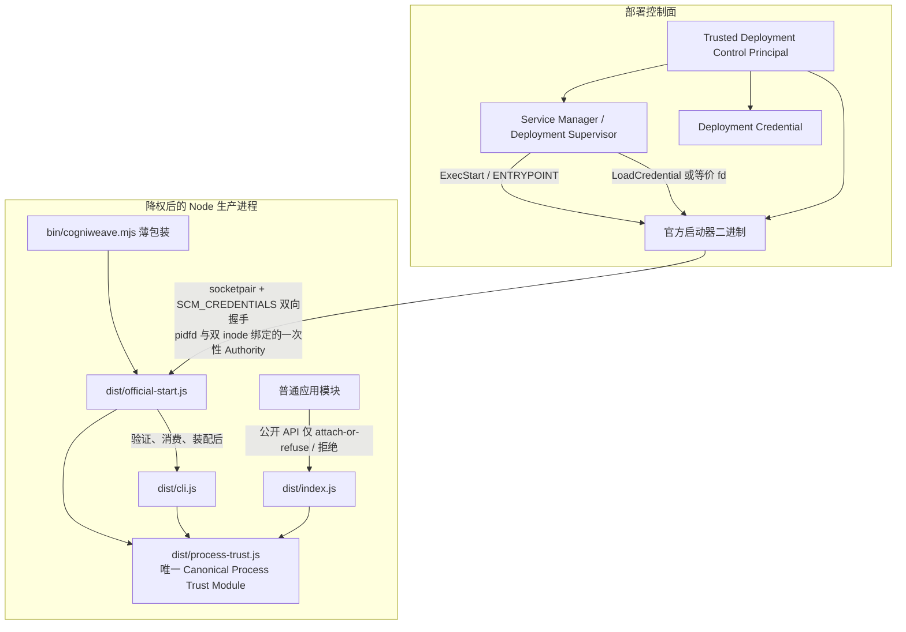
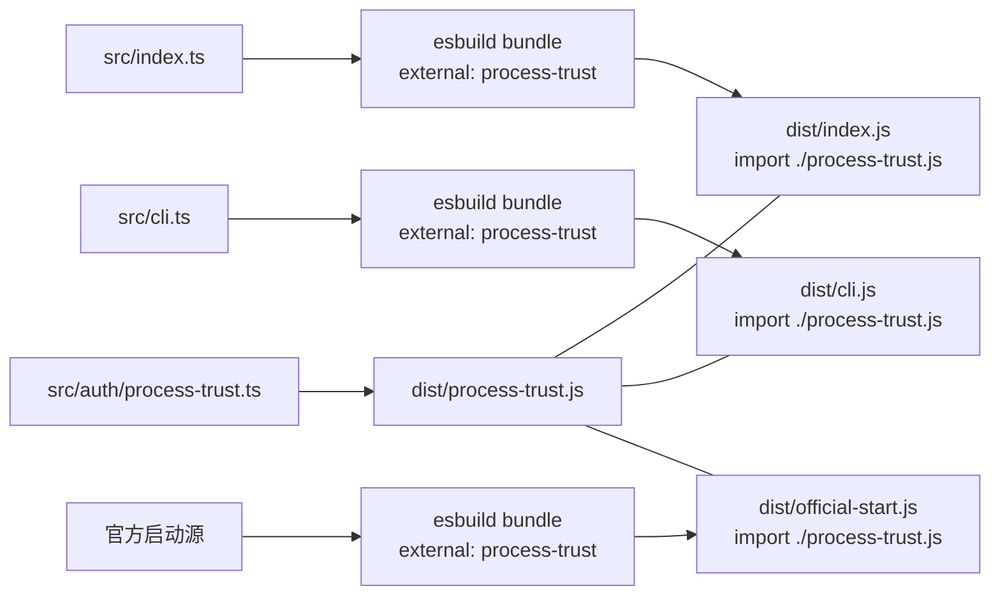

# CW-09-02-R5-B-R1-R2 Bootstrap Authority 威胁模型与设计（第三轮修订）

状态：第三轮设计评审稿。本文只修订威胁模型与安全设计，**不是实现授权，不是验收，不是已经实现，也不是已经验证**。

设计评审通过前不得开始实现，不得新增或修改测试，不得修改运行时、构建、导出或 Schema，不得提交、推送或合并。本文不批准 CW-09-01 + CW-09-02 整体验收，不批准 PR 合并，不批准生产切流，也不启动 CW-09-03。完成本任务不代表设计自动获批。必须等待独立第三轮设计评审通过，才能获得开始实现的授权。

撰写时间：2026-11-28 19:49 CST（Asia/Shanghai，UTC+8）。基线已在工作区核对，不以记忆代替核查。

---

## 修订记录

本修订回答第二轮独立设计评审的 P0-01：在 `socketpair()` 创建之后，不得把 `SO_PEERCRED` 描述为启动器验证“继承该 FD 的子进程身份”的充分依据。本文供第三轮独立设计评审使用，不代表设计获批，也不授权开始实现。

前序文档：`docs/cw-09-02-r5-b-r1-r1-bootstrap-authority.md`（第二轮评审稿，2026-11-28 18:52 CST）。该文件作为上一轮修订保留在原路径，本轮不覆盖、不删改。本文件是完整修订稿，不是补丁。

相对第二轮稿，本轮关闭的问题与对应修订如下。已锁定的 ADR-BA-01 至 ADR-BA-08 全部保持有效，不得重新开放。本轮新增 ADR-BA-09，只锁定对等凭据语义与双向握手机制，不改变既有架构决策。

| 修订 | 关闭的威胁 / 缺口 | 设计结论 |
|---|---|---|
| R1 修正 Linux Peer Credential 语义 | 把 `SO_PEERCRED`、`SCM_CREDENTIALS`、`pidfd`、`boot_id` + `starttime` 写成可相互替代的“对端凭据”，导致启动器误把“FD 创建者”当成“当前消息发送者” | 四者不可互换。`SO_PEERCRED` 记录的是 `connect` / `socketpair` 创建时的对端凭据，在 `socketpair()` 之后不随 fork/exec 更新为子进程身份。`SCM_CREDENTIALS` 记录的是消息发送时的发送方凭据。`pidfd` 绑定进程实例而不是可回收的 PID。`boot_id` + `starttime` 与 PID 提示一起标识某次启动实例，但不能代替内核发送时凭据或 `pidfd`。PID 不得作为安全身份。 |
| R2 重写双向握手协议 | 启动器仅凭 `SO_PEERCRED` 或“存在继承 FD”无法证明 Hello / Ack 由本次派生的目标子进程发出；持有被复制或转交 FD 的其他进程可能被误接受 | 子进程用发送时 `SCM_CREDENTIALS` + Deployment Credential 封印 + 官方只读验证公钥验证 Authority 确实来自受信任启动器；`SO_PEERCRED` 只作“该对是启动器 UID 在创建时建立”的次要检查。启动器用发送时 `SCM_CREDENTIALS` + `pidfd` 解析的进程实例 + 在 fork 时记录的 `boot_id` / `starttime` + 角色标注的 inode 验证消息发送方就是本次派生的目标子进程，即使对方持有复制或转交的 FD 也必须拒绝。任何失败均 fail-closed，不发送 Authority 帧，不建立生产身份，不装配 Runtime，不产生持久化副作用。 |
| R3 修正启动实例绑定 | 把“匿名 socket inode”写成双方观察到的同一值，并可能让 PID 或单一 inode 承担身份作用 | 启动实例标识 `S` 必须同时包含：`boot_id`、`starttime`、仅作辅助提示的 PID、**分别标注的**启动器端 inode 与子进程端 inode、启动器 nonce、预期官方入口与 Canonical Process Trust Module 的解析 URL / realpath。socketpair 两端是两个不同的 endpoint，任何一方都不得假设自己观察到的本地 inode 等于对端 inode。 |
| R4 更新攻击场景与测试设计 | 第二轮 T-04、T-11、T-14 及部分测试仍建立在错误的 `SO_PEERCRED` 语义上，未能覆盖创建者凭据与发送者凭据不一致、FD 转交、PID 重用、inode 角色混淆、启动器在握手各阶段退出等路径 | 重写 T-04、T-11、T-14，并微调 T-12、T-20 中依赖“对端凭据”的表述。第 13 节（现第 16 节）新增可观察退出状态、生产身份、Runtime 装配与持久化副作用的对抗测试。 |

本轮不重新开放、也不削弱：

- ADR-BA-01：公开 Bootstrap 仅 attach-or-refuse；不得公开首次装配。
- ADR-BA-02：OS / 部署权限为信任根；官方 CLI 不是信任根。
- ADR-BA-03：受控启动器与进程绑定 Authority。机制细节由 ADR-BA-09 纠正，架构决策不变。
- ADR-BA-04：外部化 Canonical Process Trust Module（`dist/process-trust.js`）。
- ADR-BA-05：OpenBot 遵循同一启动协议；无环境变量特权，无声明式例外。
- ADR-BA-06：生产身份建立为 ESM-only；CJS / Worker / 子进程独立建立必须拒绝；不得继承已消费的主实例 Authority。
- ADR-BA-07：平台 Attestation 不作为本轮主控。
- ADR-BA-08：启动器清理恶意 preload。
- R5-A 与 R5-B-R2 全部非回归要求，以及全部 fail-closed 原则。

---

## 0. 基线与范围

### 0.1 已核对基线

| 项 | 值 |
|---|---|
| 仓库 | https://github.com/flykingvip-cloud/cogniweave |
| 分支 | `cw-09-02-trusted-actor-binding` |
| 工作区 HEAD | `42a387a02b6be81c9ccee863ec3df60184805a9d` |
| Base 分支 | `cw-09-01-canonical-scope-auth`（已核对 tip：`8c758b9207289f7fd4338ffda004bbd44da03857`） |
| origin/main | `4d71354e80702ce07cd5ba99bb6a84c4ca39dc91` |
| R5-B-R1 | `ae004b6276b6516310b65901ac649d0ea6b20d3e` |
| R5-B-R2 / 当前 PR #2 Head | `42a387a02b6be81c9ccee863ec3df60184805a9d` |
| PR | https://github.com/flykingvip-cloud/cogniweave/pull/2 ，Open，未合并 |
| 上一轮威胁模型 | `docs/cw-09-02-r5-b-r1-r1-bootstrap-authority.md`（未跟踪，本轮保留原文件，不覆盖） |
| 撰写前工作区脏状态 | 仅未跟踪文件 `docs/cw-09-02-r5-b-r1-r1-bootstrap-authority.md`；无其它源码、构建或测试改动 |

前序独立复审立场（来自授权指令，本文不重新裁决）：

- R5-A-R1-R4：ACCEPTED WITH GAPS
- R5-B-R1：NOT ACCEPTED
- R5-B-R2：源码审查通过
- R5-B：NOT ACCEPTED
- 本威胁模型第一轮：NOT APPROVED
- 本威胁模型第二轮：NOT APPROVED（P0-01：`socketpair()` 之后误用 `SO_PEERCRED` 验证继承该 FD 的子进程身份）

本设计只针对：在已锁定的 Bootstrap Authority 架构下，纠正对等凭据语义，给出可实现的双向身份验证协议与无歧义的启动实例绑定，并更新相应攻击场景与测试设计。第二轮已关闭的三项架构 P0（真实信任根、抢先消费、唯一 Canonical Process Trust Module）保持锁定，不重新开放。

### 0.2 本轮只做与明确不做

只做：撰写本完整威胁模型修订稿，路径为 `docs/cw-09-02-r5-b-r1-r2-bootstrap-authority.md`，并保留一份字节级相同的审计副本 `/workspace/cogniweave-audit/cw-09-02-r5-b-r1-r2-bootstrap-authority.md`，等待第三轮设计评审。上一轮 `r1-r1` 文档保持原位。

不做：实现 Authority 验证机制或 socketpair 协议、创建官方启动器、新增或修改测试、修改生产/授权/运行时源码、修改 `package.json` exports 或 `scripts/build-sdk.mjs`、提交或推送、创建分支、合并 PR、更新 `main`、启动 CW-09-03、生产迁移或切流、建立第二套 Agent Runtime、重建 Identity Provider、重建 Credential Vault、实施平台 Attestation、修改 OpenBot 或 Knowledge SDK、删除或放宽既有授权与 Mixed Configuration 检查。

若当前代码无法支持某项设计，只在本文记录为不兼容项，不得自行实现变通。不得把本文描述成已实现或已验证。

---

## 1. 设计摘要与明确决策

### 1.1 必须回答的核心问题

在普通 Node.js 应用代码可以控制模块加载顺序、调用公开 SDK API、修改环境变量并启动子进程的前提下，系统凭什么认定某次生产 Bootstrap 是由可信部署主体授权，而不是由普通应用自行发起？

**答案（锁定，与第二轮相同，本轮补充协议层依据）：** 系统认定的依据不是进程内任何自我声明，而是一次可验证的、由 Trusted Deployment Control Principal 通过权限分离的官方启动器签发的、绑定本次进程启动实例的一次性 Bootstrap Authority。该 Authority 只能由官方启动路径在普通应用模块执行之前，经过第 6 节规定的双向身份验证、验证、消费并完成 Production Runtime 装配。冻结的 `process.env`、`process.argv`、模块私有变量、闭包、TypeScript `private`、公开函数调用顺序、调用方自声明参数、PID 相等、或“存在一个继承来的 FD”，都不得作为独立信任根。冻结环境声明永远只是 Process Environment Claim，永远不是 Bootstrap Authority，也永远不是 Production Identity。

本轮补充：启动器认定“握手消息由本次派生的目标子进程发出”，依据的是消息发送时由内核附着的 `SCM_CREDENTIALS`，以及立即在 fork 之后打开的 `pidfd` 所绑定的进程实例，而不是 `socketpair()` 创建时记录的 `SO_PEERCRED`。子进程认定“Authority 来自受信任启动器”，依据的是 Authority 帧发送时的 `SCM_CREDENTIALS`、由官方只读验证公钥验证的 Deployment Credential 封印，以及角色标注的启动实例绑定；`SO_PEERCRED` 只是关于“该 socketpair 由预期启动器 UID 在创建时建立”的次要检查，不能单独证明谁发送了当前帧。

### 1.2 必须区分的概念

以下概念互不自动升级。任何把其中一项误当作下一项的推理，都视为设计错误。

**Process Environment Claim（进程环境声明）。** 在 Canonical Process Trust Module 求值时，从当时的 `process.env` 冻结下来的一份只读声明。当前实现捕获的字段包括：`COGNIWEAVE_RUNTIME_MODE`（精确值 `production` 只表示生产请求，不是生产身份）、`COGNIWEAVE_BOOTSTRAP_AUTHORITY_ID`（当前只是字符串标签，不是不可伪造的启动凭据）、`COGNIWEAVE_ENGINE_ENVIRONMENT`（须为 `service` 或 `cloud` 才可能进入正式生产装配）、后端选择器与一份永不审计的 secret bag，以及测试夹具标记 `VITEST=true` 或 `COGNIWEAVE_TEST_HARNESS=1`。冻结只防止求值之后的篡改改写已捕获声明；它不证明求值之前的来源可信。

**Deployment Credential（部署凭据）。** 仅 Trusted Deployment Control Principal / 其 Supervisor 能交给官方启动器的部署级铸造密钥或同等机密。普通应用用户不可读。它授权启动器签发本次启动的 Bootstrap Authority，其本身不进入应用进程，也不作为公开 API 参数。子进程不得持有该凭据。

**官方验证公钥（Official Verification Key）。** 由 Trusted Deployment Control Principal 安装在固定、只读、root 所有或镜像不可变路径上的验证密钥，供官方启动路径验证 Authority 帧封印。该密钥的完整性属于部署信任根，不是进程环境声明，也不得从 `process.env`、argv 或调用方参数加载。

**Bootstrap Authority（可信启动授权）。** 由已获得 Deployment Credential 的官方启动器为**这一次**目标进程启动实例铸造、经进程外一次性通道交付、由官方启动路径验证并一次性消费的启动授权。它证明：本次正式生产装配得到了普通应用调用方无法自行签发的可信部署主体授权。它绑定第 8 节定义的启动实例标识 `S`，不得跨进程转交、重放或复用。

**Production Identity（正式生产身份）。** 进程信任快照上的正式生产身份，即 `mode === "production"` 且 `productionTrustEstablished === true`，且 `trust.simulated !== true`。只有在官方启动路径成功完成双向握手、验证、消费 Authority 并完成 Runtime 装配之后，才允许建立。握手尚未完成之前，不得应用生产身份。

**Trusted Runtime Assembly（可信运行时装配）。** 由官方生产装配路径在 assembly guard 通过后封存的、模块私有的 sealed assembly。公开 handle 不能被同形普通对象冒充。装配一旦成功封存，不可替换。

**Ordinary Application Caller（普通应用调用方）。** 同一进程内任何能够 import 公开 SDK 并调用其公开函数的代码，包括业务模块、`createTrustedRuntime()` / `createCogniWeaveRuntime()` / `new InMemoryCogniWeaveEngine()` 的调用方、公开 `bootstrapProductionTrustedRuntime()` 的调用方、公开 `runCogniWeaveCli()` 的库调用方，以及通过 Root exports、子路径 exports 或已发布物理文件路径加载 SDK 的调用方。普通应用调用方即使运行在 `environment: "service" | "cloud"` 的配置意图下，也不是 Trusted Deployment Control Principal，也不是官方启动器。

**FD 创建者凭据与消息发送者凭据。** 二者不是同一事实。对 `socketpair()` 而言，`SO_PEERCRED` 描述的是创建该对时的进程（通常是启动器），即使随后由子进程继承其中一个 FD 也不更新。`SCM_CREDENTIALS` 描述的是某次 `sendmsg` 的发送进程。持有被 `dup` 或 `SCM_RIGHTS` 转交的 FD 不是身份：若另一进程在该 FD 上发送，`SCM_CREDENTIALS` 反映的是那一进程。

### 1.3 禁止的错误推理

1. 环境变量已被冻结，所以生产身份可信。冻结不证明来源，也不证明随后的公开函数调用者。
2. Bootstrap 是唯一公开入口，所以它的调用者可信。“唯一”描述入口数量，不描述调用者身份。
3. 函数不接收参数，所以普通调用方不能滥用。无参数不是授权。
4. 使用闭包、模块私有变量或 TypeScript `private`，所以启动授权一定可信。它们不鉴定调用者。
5. 使用了官方 CLI 或官方 `bin/cogniweave.mjs`，所以具有生产授权。官方 CLI 不是信任根。
6. 普通进程自己创建了 pipe / socketpair，所以具备与启动器等价的通道。自行创建的 IPC 通道不是 Supervisor 交付的 Authority。普通进程也不能通过自建通道让官方启动路径把该进程误认为受控启动器，或让启动器把另一进程误认为本次派生的子进程。
7. 两个 bundle “导入了同一模块名”，所以它们共享一份进程信任状态。在当前 esbuild 分别打包且内联的布局下，模块名相同不表示物理文件与 ESM 实例相同。
8. `Symbol.for(...)` 进程级标记可以授予信任。它只许用于检测第二实例并 fail-closed，预置该标记是否认而不是伪造生产身份的方法。
9. `SO_PEERCRED` 报告了对端 PID / UID，所以启动器已经知道“现在使用这个继承 FD 的是本次子进程”。对 `socketpair()` 而言，该选项在创建时就已记录，fork/exec 之后不会更新为子进程当前身份。
10. 两端 `fstat` 会看到同一个 socket inode。`socketpair` 的两个 FD 是两个不同的 endpoint，各自有 inode。
11. PID 相等，所以是同一个进程实例。PID 会被重用，只能作为辅助提示。
12. 某进程持有继承或转交来的协议 FD，所以它就是合法握手方。持有 FD 不是身份。

### 1.4 已锁定的三项架构 P0（保持有效）

**架构 P0-01（信任根）。** 生产环境中唯一有权授权 CogniWeave Production Runtime 建立的主体，是 Trusted Deployment Control Principal（拥有安装与启动生产服务之 OS / 部署权限的主体）。它通过 Service Manager / Deployment Supervisor 启动一个权限受限、单独安装的官方启动程序。该启动器是唯一可以取得 Deployment Credential 并铸造 Bootstrap Authority 的程序。官方 CLI 不是信任根。普通 Node.js 进程不能仅凭执行官方 CLI 或自行创建 IPC 通道获得生产授权。启动器被非授权主体替换，或 Deployment Credential 泄漏给同时拥有启动权限的一方，属于信任根失陷；SDK 不能在库内部完整防御，但公开 API 仍必须拒绝首次装配。

**架构 P0-02（生命周期与抢先消费）。** Authority 生命周期为：Trusted Deployment Authority → Launcher Authorization → Process-bound Authority Delivery → Verification → Single Consumption → Runtime Assembly → Authority Closure。受控启动路径必须在普通应用模块执行之前完成验证、消费和 Production Runtime 装配。普通 SDK 模块不得获得首次装配所需的消费能力。公开 Root 撤回首次装配；`bootstrapProductionTrustedRuntime()` 若保留，仅为 attach-or-refuse。`runCogniWeaveCli()` 不得签发、不得绕过官方启动顺序、不得独立建立生产运行时。Authority 绑定第 8 节定义的启动实例标识 `S`，不以 PID 作为安全身份。消费后关闭通道并设置 `FD_CLOEXEC`，禁止孙进程继承。任何验证失败、通道异常、重放、身份不匹配或装配不完整均 fail-closed。

**架构 P0-03（唯一进程信任状态）。** 唯一 Canonical Process Trust Module 发布为 `dist/process-trust.js`。`dist/index.js` 与 `dist/cli.js` 必须 `import ... from "./process-trust.js"`，由 esbuild `external` 加稳定相对说明符保证不被分别内联。ESM 实例身份是解析后的模块 URL。第二份 SDK 副本或第二模块实例必须 fail-closed，且不得共享第一份已封印的内部状态。当前生产身份建立范围是 ESM-only；CJS、Worker Thread、子进程均不得独立建立生产身份，也不得继承已消费的主实例 Authority。

### 1.5 本轮关闭的协议 P0（P0-01 Peer Credential）

**协议 P0-01。** 启动器不得使用 `SO_PEERCRED` 证明“现在使用该继承 FD 的进程是本次目标子进程”。双向握手必须分别证明：（1）子进程能够验证 Authority 确实来自受信任的启动器；（2）启动器能够验证 Hello 与 Ack 确实由本次派生的目标子进程在发送时发出；（3）Authority 绑定唯一启动实例 `S`，不能跨进程转交、重放或复用；（4）socketpair 两端 inode 角色没有歧义；（5）验证失败时始终 fail-closed，不产生生产身份或可用 Runtime。该结论由第 5–8 节给出可实现定义，并由 ADR-BA-09 锁定。


---

## 2. 威胁模型及攻击者能力

### 2.1 资产

- 正式生产身份与已封存的 Trusted Runtime Assembly
- Canonical Store、SQL Client、Migration 与生产 CLI 副作用
- Bootstrap Authority 与其一次性通道
- Deployment Credential、官方验证公钥与官方启动器二进制
- 进程信任快照、assembly permit、模块私有 WeakMap 绑定
- 协议 FD、`pidfd`、启动实例标识 `S` 与握手消息

### 2.2 攻击者画像（本模型假设）

攻击者可以是同一主机上的普通应用代码、同一 OS 用户下的普通进程，或能够编写并加载 SDK 的集成宿主代码。其能力包括：

- 在 import SDK 之前或之后修改 `process.env`、`process.argv`、`process.execArgv`
- 以任意顺序 import / 动态 import 公开 Root 与 CLI bundle
- 调用全部公开 SDK API，包括 `bootstrapProductionTrustedRuntime()` 与 `runCogniWeaveCli()`
- 自行创建 pipe、`socketpair`，并把 FD 传给子进程或另一无关进程
- 在自建或转交的 FD 上发送伪造握手消息，或重放曾经观察到的合法帧字节
- 直接执行 `bin/cogniweave.mjs`、`node dist/cli.js` 或 `npx cogniweave`
- 在同一进程加载两份不同安装路径的 SDK
- 设置 `NODE_OPTIONS`、`--import`、`--require`、`--loader`（在其权限范围内）
- 创建 Worker Thread 或 Child Process
- 读取本用户可读的文件、环境与 FD（但不能读取权限正确分离后的 Deployment Credential，也不能写入权限正确限制的启动器二进制或官方验证公钥）

攻击者不被默认假设已经拥有：

- Trusted Deployment Control Principal 的 OS 启动权限
- 读取 Deployment Credential 的文件或凭据目录权限
- 替换官方启动器二进制或官方验证公钥的写权限
- 伪造内核提供的 `SO_PEERCRED` 创建时凭据，或伪造 `SCM_CREDENTIALS` 发送时凭据中的 UID / GID / PID 字段（这需要内核被攻破，或具备相应特权，例如历史上伪造他人凭据所需的 capability）

若攻击者已经具备部署权限、能读写官方验证公钥、或能伪造内核凭据，则属于第 4.4 节的信任根失陷或超出本模型的内核失陷，而不是普通应用攻击。

### 2.3 安全目标

1. 只有 Trusted Deployment Control Principal 授权的启动实例能建立正式生产身份与 Production Runtime。
2. 普通应用无法伪造、取得、抢先消费或重放 Bootstrap Authority。
3. 首次装配不通过公开 API 完成。
4. 同一进程只有一份 Canonical Process Trust 状态；第二实例 fail-closed。
5. 失败路径全部 fail-closed，且不削弱 R5-A 与 R5-B-R2 已审查边界。
6. 启动器验证的是消息发送时的真实发送方进程实例，而不是 FD 创建者，也不是单纯持有该 FD 的任意进程。
7. 子进程验证的是“这一帧 Authority 由受信任启动器在发送时发出并正确封印”，而不是“对端 socket 在创建时属于某个 UID”。

---

## 3. 信任主体与授权根

### 3.1 主体区分

| 主体 | 是否信任根 | 可否铸造 Authority | 说明 |
|---|---|---|---|
| Trusted Deployment Control Principal | 是。唯一授权根的拥有者 | 通过其控制的 Supervisor / 启动器间接铸造 | 拥有安装、配置与启动生产 CogniWeave 服务的 OS / 部署权限的主体：unit 文件所有者、Deployment Supervisor 操作账户、或拥有启动器二进制与凭据目录的服务账户 |
| Service Manager / Deployment Supervisor | 部署控制面，不是 SDK 内部主体 | 按设计铸造或把 Deployment Credential 交给官方启动器 | `systemd`、容器编排的入口控制器、或等价 Supervisor。它把官方启动器写为 `ExecStart` / `ENTRYPOINT` |
| 官方 CogniWeave 启动程序（Trusted Host Launcher） | 被授权的铸造程序，其可信性来自上一行的 OS 权限，而不是“官方”二字 | 是，且仅当由 Supervisor 启动并成功取得 Deployment Credential | 单独安装、权限受限的特权启动程序，不是可被任意用户当作铸造入口的 npm bin |
| 官方 `cogniweave` CLI / `bin/cogniweave.mjs` | 否 | 否 | 薄包装。不得自行成为信任根。不得仅因被执行而签发 Authority |
| 官方启动入口 `dist/official-start.js` | 否 | 否 | 仅按受控协议接收、验证、消费 Authority，并仅在官方启动顺序内装配 Runtime |
| 普通 Node.js 应用 | 否 | 否 | 不得铸造、消费首次装配所需 Authority，不得独立建立生产身份 |
| 普通 SDK 调用方 | 否 | 否 | 同上 |
| OpenBot 等集成宿主 | 否，除非它按本协议成为 Supervisor 启动的官方启动器，或 exec 官方受控启动器 | 不得自建例外 | 未来必须实现同一受控启动协议，或 exec 官方受控启动器。不得提供环境变量特权或调用方声明式例外 |
| Worker Thread / Child Process | 否 | 否 | 不得自行取得，不得继承主实例 Authority，不得独立建立 |

不得将“使用官方 CLI”直接等同于“具有生产授权”。

### 3.2 授权根是什么，不是什么

授权根是：Trusted Deployment Control Principal 对生产服务启动权的 OS / 部署权限控制，具体落实为：

- 谁能安装并写保护官方启动器二进制与官方验证公钥；
- 谁能编写并启用 Supervisor 清单，把该启动器指定为唯一生产入口；
- 谁能创建并只向该启动器交付 Deployment Credential。

授权根不是：npm 包里的 `bin` 字段、公开函数、冻结环境变量、模块私有快照、“进程是由 node 执行的某个官方文件名启动的”这一自我声明、PID 相等、继承 FD 的存在，或 `socketpair()` 创建时记录的 `SO_PEERCRED` 本身。

### 3.3 当前实现与该授权根的差距

对照 HEAD `42a387a`：仓库中不存在权限分离的官方启动器，也不存在 Deployment Credential 协议。`bin/cogniweave.mjs` 只是检测 `dist/cli.js` 后动态 import 并调用公开的 `runCogniWeaveCli()`；生产 `serve` 再调用公开的 `bootstrapProductionTrustedRuntime()`，而后者调用 `applyOfficialProductionTrustEstablishment()`，在 `productionRequested === true` 且非 mixed 时直接把 snapshot 升级为正式生产身份。`COGNIWEAVE_BOOTSTRAP_AUTHORITY_ID` 只检查非空字符串。这与本设计不兼容，见第 17.3 节。

---

## 4. Launcher 部署与 OS 权限边界

### 4.1 为什么启动器可信（必须是权限故事）

官方生产启动器可信，当且仅当同时满足下列部署契约：

1. **单独安装且权限受限。** 启动器是独立于普通应用树的程序（例如由 root 或部署账户安装到 `/usr/lib/cogniweave/launcher` 或镜像内的固定路径），文件所有者不是应用运行用户，权限例如 `0750` 或更严，应用用户不可写。它不是“任意用户调用 npm bin 就能铸造”的入口。
2. **由 Supervisor 清单命名为唯一生产入口。** 生产 unit / 容器清单的 `ExecStart` 或 `ENTRYPOINT` 必须指向该启动器，而不是 `node app.js`、不是公开 `npx cogniweave`、也不是直接 `node dist/cli.js`。
3. **铸造必须取得 Deployment Credential。** 例如 `systemd` `LoadCredential=` / `CREDENTIALS_DIRECTORY`、Supervisor 传入的匿名 FD，或仅启动器可打开的密钥文件。该凭据对应用用户不可读（文件权限、独立凭据目录、或仅在启动器 PID 的 FD 表中）。
4. **强制权限分离。** Node 应用必须以降权后的用户运行，该用户不能读取 Deployment Credential，也不能替换启动器二进制或官方验证公钥。启动器在取得凭据、创建通道并 `exec` 官方启动入口时，将目标进程降为该应用用户。
5. **交付通道必须支持双向、发送时的内核凭据，而不是创建时凭据。** 锁定为：启动器创建匿名 `socketpair(AF_UNIX, SOCK_STREAM)`（不得用普通 pipe 代替，因为 pipe 不能携带 `SCM_CREDENTIALS`），在 fork 后立即打开子进程的 `pidfd`，降权 `exec` 官方启动入口并只让子进程端 FD 为该协议继承。官方启动路径与启动器按第 6 节完成双向握手。子进程用发送时 `SCM_CREDENTIALS` 与官方验证公钥验证 Authority 帧来自启动器；`SO_PEERCRED` 只作为“该对由启动器 UID 在创建时建立”的次要检查。启动器用发送时 `SCM_CREDENTIALS` 与 `pidfd` 绑定的进程实例验证 Hello / Ack 来自本次子进程，不得使用 `SO_PEERCRED` 作为该证明。普通应用自建 socketpair 时，既没有 Deployment Credential 封印，其发送时凭据也不是官方启动器进程；创建时 `SO_PEERCRED` 只能反映该应用自己。必须被拒绝。

同一 UID 部署（应用代码能够读取 Deployment Credential，或能够改写启动器或验证公钥）是信任根的错误配置。SDK 仍然拒绝公开 API 首次装配，但不能完整防御把部署主体机密交给应用代码的部署。该条件必须写进部署契约；官方启动路径在无法取得真实 Supervisor 交付凭据时 fail-closed。在同一 UID 下，`SCM_CREDENTIALS.uid` 与 `SO_PEERCRED.uid` 都不能区分启动器与应用，签名与 `pidfd` / `starttime` 绑定仍然有意义，但若 Deployment Credential 同时可读，则属于部署契约失败。

### 4.2 谁做什么

| 问题 | 答案 |
|---|---|
| 谁安装、配置和控制 Launcher？ | Trusted Deployment Control Principal。通过受控镜像、配置管理或包安装把启动器放到写保护路径，安装官方验证公钥，并维护 Supervisor 清单。 |
| 谁拥有启动生产服务的 OS / 部署权限？ | 同一主体及其被授权的 Supervisor（例如能够 `systemctl start` 该 unit、能够滚动该生产 Deployment 的账户）。普通应用用户没有该权限。 |
| 哪个主体可以创建并交付 Authority？ | 仅由 Supervisor 启动、并成功取得 Deployment Credential 的官方启动器。 |
| 普通应用能否调用相同铸造入口？ | 不能。npm bin / 公开 CLI / 公开 SDK API 都不是铸造入口。应用用户即使执行启动器二进制，若无法读取 Deployment Credential，必须失败。即使它自建通道并 exec 官方启动入口，也无法产生合法封印，也无法让官方路径把该应用进程误认为受控启动器。 |
| 普通用户或普通进程能否伪造 Launcher 身份？ | 不能仅凭 exec 公开 CLI、自建 pipe/socketpair、或持有一个复制的 FD 伪造。在权限分离正确的前提下，要让子进程接受 Authority 帧，攻击者必须在发送时以启动器 UID 发出该帧，并使用 Deployment Credential 产生可通过官方验证公钥校验的封印。这已经超出普通应用攻击者能力。伪造内核凭据字段属于内核失陷，见第 17.5 节。 |
| Launcher 被错误配置、权限不足或遭到替换时如何失败？ | 官方启动路径拿不到真实 Supervisor 交付的、可通过官方验证公钥校验的 Authority 帧，或发送时凭据、启动实例绑定不匹配，必须拒绝生产建立。若替换者已经拥有写启动器与启动服务的权限，见 4.4。 |

### 4.3 推荐部署形态

- **systemd：** unit 以特权或专用 `cogniweave-launcher` 用户启动启动器；`LoadCredential=` 注入部署凭据；`User=` / `Group=` 仅作用于被降权的应用进程，或由启动器自行降权；`NoNewPrivileges=`、只读挂载与不可变镜像为推荐加固。
- **容器：** `ENTRYPOINT` 为官方启动器；Deployment Credential 通过编排系统的密钥挂载（仅启动器可写/可读的路径）注入；应用进程以非 root、非密钥所有者用户运行。
- **OpenBot 宿主：** 见第 12 节，必须走同一 Supervisor 协议或 exec 官方启动器，不得用环境变量开例外。
- **PID 命名空间：** 本协议要求启动器与本次官方子进程处于同一 PID 命名空间，以便 `SCM_CREDENTIALS.pid`、`pidfd` 与 `/proc/<pid>/stat` 指向同一套进程标识。跨 PID 命名空间派生官方子进程不是本轮支持的生产建立路径；若未来需要，必须单独设计。

### 4.4 信任根失陷与必须拒绝

| 情形 | 分类 | 安全结果 |
|---|---|---|
| 普通应用自行启动官方 CLI | 必须拒绝 | 公开 CLI 不得铸造；无 Supervisor 通道与合法双向握手则不得建立生产身份 |
| 普通应用自行创建 pipe/socketpair | 必须拒绝 | 自建通道没有 Deployment Credential 封印；发送时 `SCM_CREDENTIALS` 不是官方启动器；创建时 `SO_PEERCRED` 只反映该应用自己。官方路径必须 fail-closed |
| 普通应用将协议 FD 转交给另一进程 | 必须拒绝 | 另一进程发送 Hello / Ack 时，`SCM_CREDENTIALS` 是那一进程，与启动器 `pidfd` 绑定的子进程实例不一致；即使它读到已发送的合法 Authority 帧，`S` 也绑定原启动实例，不得在另一进程消费 |
| 普通应用伪造启动参数或环境变量 | 必须拒绝 | env / argv 只是声明，不是 Authority |
| 未授权进程执行官方 bin | 必须拒绝 | 与第一行相同，执行官方 bin 本身不构成授权 |
| Launcher 被非授权主体替换 | 信任根失陷 | 若替换者同时拥有生产启动权，SDK 无法在库内部证明二进制真伪。应使用不可变镜像与文件完整性（只读挂载、包校验、签名镜像）。官方启动路径在无法取得真实 Supervisor 凭据或官方验证公钥校验失败时仍须 fail-closed |
| Launcher 的 Deployment Credential 泄漏给同时拥有启动权限的一方 | 信任根失陷 | 持有凭据且能启动启动器的主体已经等价于部署控制者。SDK 不能防御该失陷，但公开 API 仍不得自行首次装配 |
| 同一 UID 部署导致应用可读凭据 | 错误配置 / 部分失陷 | 公开 API 仍拒绝首次装配；基于 UID 的 `SO_PEERCRED` / `SCM_CREDENTIALS.uid` 区分失效。必须在部署契约中禁止，并在评审与运维检查中视为不合规 |
| 内核级伪造 `SO_PEERCRED` 或 `SCM_CREDENTIALS` | 超出本模型 / 信任根 | 需要攻破内核或持有相应特权。SDK 不能在用户态防御内核失陷 |

---

## 5. Linux Peer Credential 语义

本节的四种机制**不得相互替代**。每项都写明：由哪一方调用、在哪个时间点采集凭据、验证哪些字段、哪些字段由内核提供、哪些由应用协议提供、能拒绝哪些攻击、哪些残余仍属于部署信任根或内核失陷范围。

本设计的目标平台是 Linux。若某平台不能提供与本节等价的、不可相互替代的原语，该平台不得声称支持生产身份建立。

### 5.1 `SO_PEERCRED`（`getsockopt`）

- **内核语义。** 对已连接的 `AF_UNIX` socket，`getsockopt(..., SOL_SOCKET, SO_PEERCRED, ...)` 返回 `struct ucred { pid, uid, gid }`。这些字段是内核在 **`connect(2)` 或 `socketpair(2)` 创建时**记录的对端凭据，而不是“当前正在使用该 FD 的进程”的凭据，也不是“最近一次 send 的发送方”的凭据。
- **对 `socketpair()` 的关键事实。** `socketpair()` 的两端在创建进程中同时被创建且已经处于连接状态。因此两端记录的对端凭据都是**创建者**（通常是启动器）在创建那一刻的 pid/uid/gid。随后的 `fork` / `exec` **不会**把 `SO_PEERCRED` 更新为继承该 FD 的子进程当前身份。启动器在自己的一端调用 `SO_PEERCRED`，看到的仍然是创建时的对端，也就是它自己，而不是子进程。
- **由哪一方调用、何时采集。** 任何持有该 socket FD 的进程都可以在之后任意时刻调用。采集到的值反映的是创建/连接时的记录，不是调用时刻的对端身份。
- **内核提供的字段。** `pid`、`uid`、`gid`。没有应用协议字段。
- **允许的用法。** 子进程可以把 `SO_PEERCRED` 用作**次要检查**：该 socketpair 是由预期的启动器 UID、以及创建时的启动器 PID 建立的。它不能证明谁发送了当前这一帧，也不能单独作为接受 Authority 的充分条件，更不能替代 `SCM_CREDENTIALS`。
- **禁止的用法。** 启动器不得使用 `SO_PEERCRED` 证明“现在使用该继承 FD 的进程是本次目标子进程”。任何把该选项写成启动器验证子进程充分依据的实现或文档，都应在审查中被拒绝。
- **能拒绝的攻击。** 在权限分离正确（启动器 UID ≠ 应用 UID）时，普通应用自建 socketpair 再 exec 官方启动入口，子进程的次要检查会看到创建者是应用 UID，从而拒绝。这只是一层辅助拒绝，不是完整证明。
- **不能单独拒绝的攻击。** 持有从真实启动器创建的 socketpair 上被复制或转交的 FD 的其他进程：`SO_PEERCRED` 仍然显示启动器为创建者。PID 重用也不会改变已记录的创建时凭据。因此它不能解决本轮 P0。
- **残余范围。** 伪造该内核记录需要内核被攻破或具备相应特权，属于超出本模型的信任根 / 内核失陷。同一 UID 部署下，创建者 UID 与应用 UID 相同，本检查失去区分力。

### 5.2 `SCM_CREDENTIALS`（`sendmsg` / `recvmsg`，并启用 `SO_PASSCRED`）

- **内核语义。** 接收方对 socket 设置 `SO_PASSCRED` 后，内核在**发送时刻**把发送进程的 `struct ucred { pid, uid, gid }` 作为控制消息附着到该次 `recvmsg`。字段反映的是实际调用 `sendmsg` / 等价发送接口的那个进程，而不是 FD 的创建者，也不是仅仅持有该 FD 的某个其他进程。
- **由哪一方调用、何时采集。** 启动器在接收 Hello / Ack 之前对其启动器端 FD 设置 `SO_PASSCRED`，并在 `recvmsg` 时读取控制消息。子进程在接收 Authority 帧之前对其子进程端 FD 设置 `SO_PASSCRED`，并在 `recvmsg` 时读取控制消息。双方在发送自己的帧时使用 `sendmsg`；发送方不必也不应依赖自己填写可被伪造的凭据字段，而应由内核在发送时附着真实发送方凭据。未特权进程不能把这些字段伪造成其他 UID。
- **内核提供的字段。** 该次发送的 `pid`、`uid`、`gid`。应用协议载荷（Hello、Authority、Ack 中的 `boot_id`、`starttime`、inode、nonce、入口 URL 等）不是内核凭据，必须另行校验。
- **允许的用法。** 这是证明“谁实际发送了这一帧”的机制。启动器必须用它验证 Hello / Ack 的发送方。子进程必须用它验证 Authority 帧的发送方。
- **与持有 FD 的关系。** 持有被 `dup` 或 `SCM_RIGHTS` 转交的 FD 不是身份。若另一进程在该 FD 上发送，`SCM_CREDENTIALS` 反映那一进程，启动器必须拒绝。
- **能拒绝的攻击。** 普通应用在自建或转交的 FD 上伪造握手；无关进程持有复制 FD 后发送 Hello / Ack；把合法帧字节改由另一进程重新发送（新一次发送的内核凭据是那一进程，不是原启动器）。
- **不能单独完成的事项。** `SCM_CREDENTIALS.pid` 仍只是一个 PID 提示，必须与 `pidfd` 以及 `boot_id` + `starttime` 一起绑定到进程实例，以对抗 PID 重用。它不能代替 Deployment Credential 封印，也不能代替启动实例 `S` 的应用协议绑定。它证明的是**进程实例**在发送，不能单独证明该进程内尚未被恶意 preload 抢先执行——后者由 ADR-BA-08 的 exec 边界清理与“官方启动路径先于普通模块完成装配”来覆盖。同一进程内的代码共享同一组发送时凭据。
- **残余范围。** 伪造发送时内核凭据需要内核失陷或相应特权。同一 UID 下 `uid` 字段不能区分启动器与应用，必须依赖封印与进程实例绑定。若 Supervisor 允许恶意 preload 在官方启动路径之前于同一子进程内运行，则该 preload 的发送凭据与目标子进程相同，属于部署控制面扩大信任根，见 ADR-BA-08 与第 17.5 节。

### 5.3 `pidfd`

- **内核语义。** `pidfd_open(pid, flags)` 返回指向**那个进程实例**（其 task）的文件描述符，而不是指向一个可被回收的 PID 数字。原进程退出后，即使其 PID 被新进程重用，原 `pidfd` 仍指向已退出的那个实例，不会静默转向新进程。
- **由哪一方调用、何时采集。** 仅启动器，且必须在 `fork` 成功之后**立即**对本次子进程调用 `pidfd_open`，在任何后续握手、等待或可能的 PID 回收窗口之前完成。启动器在整个握手期间持有该 `pidfd`，并用它解析“当前这次派生的子进程”而不是“某个等于某数字的 PID”。
- **验证哪些字段。** 启动器在收到 Hello / Ack 时，必须通过该 `pidfd` 解析子进程当前 PID（优先使用内核提供的 pidfd 信息接口，例如 `PIDFD_GET_INFO`，或 `/proc/self/fdinfo/<pidfd>` 中与该 pidfd 绑定的 `Pid` 字段，或同等的、不会因 PID 重用而转向其他实例的内核映射），并要求 `SCM_CREDENTIALS.pid` 等于该 PID。同时要求该进程仍是 pidfd 指向的活实例（例如对 pidfd 做不会造成误杀的存活性检查），且其 `/proc/<pid>/stat` 的 `starttime` 与 `/proc/sys/kernel/random/boot_id` 与 fork 时记录值一致。
- **内核提供与应用提供。** `pidfd` 本身及其映射出的 PID / 存活性由内核提供。`boot_id`、`starttime` 来自 `/proc`，由启动器在 fork 后读取并在协议中比对；它们不是 `pidfd` 的替代品。
- **允许的用法。** 把 Hello / Ack 中的 PID 提示和 `SCM_CREDENTIALS.pid` 绑定到 fork 时的那个进程实例。
- **禁止的用法。** `pidfd` 不是 `SCM_CREDENTIALS` 的替代品：它不证明谁发送了当前消息。也不得只比较 PID 数字而不通过 pidfd 解析实例。
- **能拒绝的攻击。** PID 重用后，新进程使用相同 PID 提示发送 Hello；原目标子进程已退出后的冒充。
- **残余范围。** 不能在用户态防御内核失陷。本轮要求启动器与子进程共享 PID 命名空间，见 4.3。

### 5.4 `/proc` `starttime` 与 `boot_id`

- **语义。** `boot_id`（`/proc/sys/kernel/random/boot_id`）标识一次内核启动。`starttime` 是 `/proc/<pid>/stat` 中该进程自本次启动以来的启动时刻（解析时必须正确跳过 `comm` 字段中可能含空格与括号的部分，取标准 `starttime` 字段）。二者与 PID 提示一起，标识“某次启动上的某个进程实例”。
- **由哪一方调用、何时采集。** 启动器在 fork 之后、握手之前读取子进程的 `starttime` 与系统 `boot_id` 并记录。子进程在发送 Hello 前读取自己的 `/proc/self/stat` `starttime` 与 `boot_id`，放入应用协议载荷。双方在验证时比对。
- **内核 / `/proc` 提供的字段。** `boot_id`、`starttime`。PID 只是辅助提示。应用协议把这些值放入 Hello 与 `S`，但它们的权威来源是 `/proc` 与启动器在 fork 时的记录，而不是调用方自声明。
- **允许的用法。** 作为启动实例标识 `S` 的组成部分，防止同一 PID 被新进程复用后复用旧绑定。
- **禁止的用法。** 不得替代内核发送时凭据，不得替代 `pidfd`，不得把 PID 本身当作安全身份。
- **能拒绝的攻击。** 相同 PID 提示但 `starttime` 不同的重放或冒充；跨 reboot 后 `boot_id` 变化导致旧 `starttime` 失去可比性时的旧帧重用。
- **残余范围。** `/proc` 的真实性依赖内核与正确的挂载。能任意改写自己看到的 `/proc` 或伪造内核地址空间的攻击者，超出本模型。

### 5.5 机制对照

| 机制 | 采集时间 | 描述对象 | 启动器用于验证子进程？ | 子进程用于验证启动器？ |
|---|---|---|---|---|
| `SO_PEERCRED` | `connect` / `socketpair` 创建时 | FD 创建/连接时的对端 | 不得作为充分依据，也不得作为主要依据 | 仅次要检查：该对由预期启动器 UID 在创建时建立 |
| `SCM_CREDENTIALS` | 每次 `sendmsg` 时 | 该次消息的真实发送进程 | 是，主要依据之一，且必须与 `pidfd` 及 `starttime` / `boot_id` 结合 | 是，主要依据之一，且必须与封印及 `S` 结合 |
| `pidfd` | fork 后立即 | 本次派生的进程实例 | 是，用于把 PID 提示绑定到实例 | 不由子进程用来鉴定启动器 |
| `boot_id` + `starttime` | fork 后 / Hello 发送前 | 某次启动上的进程实例 | 是，与 pidfd、发送时凭据一起核验 | 是，与帧内 `S` 比对 |
| PID | 任意时刻的数字 | 可被回收的标识 | 仅辅助提示 | 仅辅助提示 |
| Deployment Credential 封印 + 官方验证公钥 | 启动器发送 Authority 时封印，子进程接收时验签 | 帧由持有部署凭据的启动器签发 | 启动器持有私钥/封印密钥，不向子进程出示 | 是，证明帧内容未被普通应用伪造 |
| 应用协议载荷 | 握手过程 | 入口、模块 URL、inode 角色、nonce 等 | 必须与 fork 时记录和发送时凭据一起核验，不能单独建立身份 | 必须与封印和发送时凭据一起核验 |

---

## 6. 双向身份验证协议

本节给出可实现的协议定义。生产身份不得在握手与装配全部成功之前被应用。任何步骤失败都必须 fail-closed：不发送 Authority 帧（若尚未发送），不建立生产身份，不装配可用 Runtime，不产生持久化副作用。

不得仅凭 PID 相等、环境变量、argv、调用方声明、或继承 FD 的存在来建立身份。

### 6.1 通道与 FD 表约定

- 通道锁定为 `socketpair(AF_UNIX, SOCK_STREAM, 0, sv)`。不得用普通 pipe 代替。
- `SOCK_STREAM` 可能合并或分割字节流，因此协议帧必须带有明确的长度前缀（例如 4 字节大端长度 + 载荷），每次 `sendmsg` / `recvmsg` 以完整帧为单元读取。控制消息中的 `SCM_CREDENTIALS` 属于该次完整帧。
- 启动器在创建后立即对**两端**做 `fstat`，分别记录启动器端 inode 与子进程端 inode（`st_dev` + `st_ino`）。二者是不同的 endpoint，不得当成同一个 inode。
- 仅清除子进程端的 `FD_CLOEXEC`，使其能在官方 `exec` 后仍然可用。启动器端应保持 `FD_CLOEXEC`，以免启动器自身意外 exec 时泄漏。
- `fork` 之后，启动器（父进程）必须立即关闭自己持有的那份**子进程端** FD，只保留启动器端 FD 与 `pidfd`。子进程必须关闭启动器端 FD，只保留子进程端。
- 启动器在 `exec` 前清理子进程 FD 表：除标准输入/输出/错误（若按部署保留）与协议子进程端之外，关闭其余继承 FD。协议 FD 以**代码常量规定的固定编号**交给官方启动入口（本设计锁定为文件描述符 `3`）。该编号是实现约定，不是环境变量，不得由 `process.env` 或 argv 选择。
- 官方启动路径只使用该固定编号上的 FD 进行本协议。普通应用把自建 socket 放到 FD 3 再执行官方入口，仍必须在握手验证中失败。
- 双方在接收之前设置 `SO_PASSCRED`。

### 6.2 协议帧（设计级字段，非形式化 RFC 文法）

所有帧都包含：`type`、`version`。版本不识别则拒绝。载荷不得把 Deployment Credential、封印私钥或 nonce 明文写入环境、argv、日志、审计或磁盘。

**Hello（子进程 → 启动器）**

- `type = HELLO`
- `boot_id`：子进程读取的 `/proc/sys/kernel/random/boot_id`
- `starttime`：子进程读取的 `/proc/self/stat` 启动时刻
- `pid_hint`：`getpid()`，仅辅助提示，不是安全身份
- `child_local_inode`：子进程对其协议 FD 做 `fstat` 得到的本地 endpoint inode（`st_dev` + `st_ino`）
- `intended_official_entry`：本进程预期官方启动入口的解析路径或模块 URL
- `canonical_process_trust_module_url`：Canonical Process Trust Module 解析后的 URL / realpath
- `child_nonce`：子进程生成的高熵一次性随机数

内核在发送时附着 `SCM_CREDENTIALS {pid, uid, gid}`。

**Authority（启动器 → 子进程，仅在 Hello 验证通过后发送）**

- `type = AUTHORITY`
- `launcher_nonce`：启动器生成的高熵一次性随机数 `N`，每个启动实例唯一
- 启动实例标识 `S` 的完整字段，见第 8 节，其中必须**分别标注** `launcher_end_inode` 与 `child_end_inode`
- `hello_binding`：对已验证 Hello 字段（含 `child_nonce`）的绑定，例如规范化编码后的加密哈希
- `intended_official_entry`、`canonical_process_trust_module_url`
- `issued_at`、`expires_at`：短时有效，仅覆盖握手与装配窗口
- `seal`：在 Deployment Credential 下对上述字段的封印或签名。私钥或铸造密钥不得离开启动器，不得进入子进程

内核在发送时附着 `SCM_CREDENTIALS {pid, uid, gid}`（启动器的发送时凭据）。

**Ack（子进程 → 启动器）**

- `type = ACK`
- `child_nonce`、`launcher_nonce`：绑定本次握手
- 可选：消费确认摘要（不得包含可重放的明文 Authority）

内核在发送时附着 `SCM_CREDENTIALS {pid, uid, gid}`。

### 6.3 步骤、系统调用与核验

**步骤 1。启动器准备通道并派生目标进程。**

启动器在取得 Deployment Credential、并且在把控制权交给任何应用模块之前：

1. 调用 `socketpair(AF_UNIX, SOCK_STREAM, 0, sv)`。
2. 对两端调用 `fstat`，记录 `launcher_end_inode` 与 `child_end_inode`。确认二者不同，否则 fail-closed。
3. 按 6.1 设置 `FD_CLOEXEC` 与固定 FD 编号。
4. 调用 `fork`。
5. 立即对子进程调用 `pidfd_open`。
6. 读取并记录系统 `boot_id` 与 `/proc/<child_pid>/stat` 的 `starttime`，记下此时的 PID 仅作提示。
7. 父进程关闭子进程端 FD。
8. 子进程关闭启动器端 FD，并 `exec` 官方启动入口。目标进程以降权应用用户运行。启动器在 `exec` 边界剥离恶意 preload（ADR-BA-08），并清理 FD 表。

此时尚未存在生产身份，也尚未发送 Authority。

**步骤 2。官方启动路径在任何普通应用模块运行之前发送 Hello。**

官方启动入口（`dist/official-start.js` 或其不可公开的内部例程）是进程入口，不是应用 `main`。它：

1. 只使用固定编号上的协议 FD；缺失、非 `AF_UNIX` socket 或无法 `fstat` 则 fail-closed。
2. 设置 `SO_PASSCRED`。
3. 读取 `boot_id`、`/proc/self/stat` 的 `starttime`、`pid_hint`、本地 inode、解析后的官方入口与 `dist/process-trust.js` URL。
4. 生成 `child_nonce`。
5. 调用 `sendmsg` 发送 Hello。内核附着发送时 `SCM_CREDENTIALS`。

公开 API 不得发送 Hello，不得完成握手，不得进行首次装配。

**步骤 3。启动器接收 Hello，验证的是消息发送方，而不是 FD 创建者。**

启动器对启动器端设置 `SO_PASSCRED`，`recvmsg` 读取完整 Hello 帧及其 `SCM_CREDENTIALS`。然后必须**全部**通过：

1. 帧格式、版本、长度合法；`child_nonce` 熵足够且非全零。
2. `SCM_CREDENTIALS.pid` 等于通过 `pidfd` 解析出的当前子进程 PID，而不是仅仅等于 fork 时记下的数字，也不是 `SO_PEERCRED.pid`。
3. 该 PID 对应进程的 `starttime` 与 `boot_id` 等于 fork 时记录值；Hello 载荷中的 `boot_id` / `starttime` 也必须与记录值一致。
4. `SCM_CREDENTIALS.uid` / `gid` 等于握手时预期的降权子进程 UID / GID。
5. Hello 中的 `child_local_inode` 必须等于创建时记录的**子进程端** inode，而不是启动器端 inode。
6. `intended_official_entry` 与 Canonical Process Trust Module URL / realpath 必须与本次启动计划一致。
7. 发送方必须是 `pidfd` 指向的那个实例。任何其他进程发来的消息，即使它持有复制或转交的 FD，都必须拒绝。

启动器在此步骤**不得**使用 `SO_PEERCRED` 作为上述任何一项的充分依据。`SO_PEERCRED` 在此处通常仍描述创建者自己，没有信息价值。

任一不匹配：fail-closed，不发送 Authority 帧，关闭协议 FD，不建立生产身份，无 Runtime，无持久化副作用。子进程因超时、EOF 或错误而 fail-closed。

**步骤 4。仅在 Hello 验证通过后，启动器发送 Authority 帧。**

启动器构造第 8 节的 `S` 与 Authority 帧，用 Deployment Credential 封印，然后 `sendmsg` 发送。内核附着启动器在发送时的 `SCM_CREDENTIALS`。子进程不能持有 Deployment Credential。

**步骤 5。子进程验证 Authority 帧。**

子进程 `recvmsg` 读取完整帧及其发送时 `SCM_CREDENTIALS`，并**全部**通过下列检查后才可发送 Ack 并进入消费：

1. **发送时凭据（主要）。** `SCM_CREDENTIALS.uid` / `gid` 必须等于部署安装的预期启动器 UID / GID（与官方验证公钥一同由 Trusted Deployment Control Principal 安装，不得来自环境变量或 argv）。`SCM_CREDENTIALS.pid` 必须等于创建该 socketpair 的启动器进程，即与次要检查中 `SO_PEERCRED.pid`（创建时对端 PID）为同一进程实例；必要时再对照该 PID 在 `/proc` 上仍为同一 `starttime`。这一步证明**谁发送了这一帧**。若另一进程（即使 UID 相同）持有被转交的启动器端 FD 并发送伪帧，其发送时 PID 与创建时 PID 不一致，必须拒绝。仅有 PID 一致仍不足：还必须通过封印校验。
2. **`SO_PEERCRED`（仅次要）。** 可以检查该对是在启动器 UID、创建时启动器 PID 下建立的，并用于与上一款的发送时 PID 对照。它不证明谁发送了当前帧，也不能单独构成接受条件。
3. **封印。** 使用官方、只读、root 所有或镜像不可变路径上的验证公钥验证 `seal`。密钥路径由部署安装，不得来自环境变量或 argv。校验失败则拒绝。
4. **inode 角色。** 子进程对自己协议 FD 的 `fstat` 本地 inode 必须等于帧内标注的 `child_end_inode`。帧内 `launcher_end_inode` 必须存在且与 `child_end_inode` 不同。子进程不得假设两端共享一个 inode，也不得用启动器端 inode 冒充本地 inode。
5. **启动实例与入口。** 帧内 `S` 的 `boot_id`、`starttime` 与本进程一致；`intended_official_entry` 与 Canonical Process Trust Module URL 与本进程解析结果一致。
6. **时效与一次性。** 未过期；`launcher_nonce` 合法；尚未消费；通道未关闭。
7. Hello 绑定与 `child_nonce` 一致，防止把给另一次 Hello 的帧接到本次通道。

任一失败：fail-closed，不发送成功 Ack，不消费，不装配，不建立生产身份。

验证通过后，子进程 `sendmsg` 发送 Ack（内核再次附着 `SCM_CREDENTIALS`）。启动器以与 Hello 相同的发送方验证规则核验 Ack。随后双方关闭协议 FD，并对任何残留描述符设置 `FD_CLOEXEC`，使孙进程不能继承仍然可用的通道。Authority 是一次性的：在成功消费、关闭通道、或启动器在完整握手完成之前退出之后立即无效。

**步骤 6。只有成功验证并且成功消费之后，官方启动路径才装配 Production Runtime。**

若启动器在握手前、握手中、或 Authority 已交付但官方路径尚未完成消费与装配时退出，结果一律 fail-closed：无生产身份，无可用 Runtime，无持久化副作用。公开 API 仍是 attach-or-refuse，不能完成握手，也不能完成首次装配。

### 6.4 子进程如何验证启动器（摘要）

- 用 **发送时** `SCM_CREDENTIALS` 验证 Authority 帧的发送方 UID，并核验发送方进程与启动器实例的一致性。
- 用官方验证公钥验证 Deployment Credential 封印；子进程自己没有铸造密钥。
- 用帧内 `S` 验证预期官方启动入口、Canonical Process Trust Module 身份、角色标注的 inode、`boot_id`、`starttime`、nonce 与短时窗。
- `SO_PEERCRED` 只作创建时次要检查。
- 不得凭 env、argv、PID 相等或“拿到了一个 FD”接受该帧。

### 6.5 启动器如何验证子进程（摘要）

- 用 **发送时** `SCM_CREDENTIALS` 验证 Hello / Ack 的发送方。
- 通过 fork 后立即打开的 `pidfd` 把 `SCM_CREDENTIALS.pid` 绑定到本次派生的进程实例，再核对 fork 时记录的 `starttime` 与 `boot_id`，以及握手时预期的子进程 UID。
- 核验 Hello 中的启动实例信息：子进程本地 inode 必须等于创建时的子进程端 inode，入口与模块 URL 必须等于启动计划。
- 拒绝任何其他进程发送的消息，即使其持有复制或转交的 FD。
- 不得使用 `SO_PEERCRED`、不得仅凭 PID 相等、不得仅凭继承 FD 存在来建立该身份。

### 6.6 失败动作

下列任一情形都必须 fail-closed，且生产身份不得被标记为已建立：

- 系统调用失败、通道 EOF、超时、短读、长度非法、版本不识别
- `SCM_CREDENTIALS` 缺失、不可解析，或与预期发送方实例不一致
- `pidfd` 无法解析、子进程已退出、或与发送方 PID 不一致
- `boot_id` / `starttime` / inode 角色 / 入口 / 模块 URL 不匹配
- 封印校验失败、官方验证公钥不可读或不可信
- 重复 Hello、重复 Authority、重复 Ack、或在错误阶段收到帧
- 启动器在消费与装配完成前退出
- 公开 API 试图发起或完成握手

失败时不得降级到 `NODE_ENV` 或 `COGNIWEAVE_RUNTIME_MODE`，不得接受调用方自声明 Principal 或注入的 Provider / Store，不得通过普通 non-production 路径继续生产 Store 操作。

---

## 7. Authority 完整生命周期

锁定链与第二轮相同，本轮只纠正交付、验证与消费步骤中的凭据与绑定语义：

```
Trusted Deployment Authority
        → Launcher Authorization
        → Process-bound Authority Delivery
        → Verification
        → Single Consumption
        → Runtime Assembly
        → Authority Closure
```

### 7.1 Trusted Deployment Authority

- 创建主体：Trusted Deployment Control Principal 在部署时配置 Deployment Credential，安装官方验证公钥，并把凭据交给 Supervisor 的凭据机制。
- 交付主体：Supervisor（`LoadCredential`、密钥卷、匿名 FD）。
- 接收主体：仅官方启动器进程。
- 验证主体：启动器确认自己能够按部署契约打开凭据；失败则拒绝启动目标 Node 进程。
- 消费主体：启动器只使用该凭据铸造本次 Bootstrap Authority，不得把它写入环境、argv、日志、审计或应用可访问文件系统，也不得把它交给子进程。
- 失效条件：凭据轮换、权限错误、文件不可读、Supervisor 未注入。
- 重放保护：Deployment Credential 不是一次性应用层令牌；它的保护靠 OS 权限与轮换。一次性语义在下一环的 Bootstrap Authority 上实施。
- 错误处理：启动器失败退出，不启动应用，不建立生产身份。

### 7.2 Launcher Authorization

- 创建主体：官方启动器在确认 Deployment Credential 可用后，为即将启动的目标进程生成高熵 nonce `N` 与启动实例意图（目标官方入口、Canonical Process Trust Module、SDK 主版本、短时间窗）。
- 交付 / 接收：尚不交给应用。启动器按第 6 节创建 `socketpair`，记录两端 inode，准备 `pidfd` 与启动实例记录。
- 错误处理：任何铸造前失败都不得留下半开通道或明文 `N` 文件。

### 7.3 Process-bound Authority Delivery

交付过程就是第 6 节的双向握手，此处不重复系统调用细节，只锁定主体与失效条件：

- 创建 / 交付主体：已取得 Deployment Credential 的官方启动器。它只在 Hello 的发送方验证通过之后才发送封印的 Authority 帧。
- 接收主体：本次 `pidfd` 绑定的、已 exec 官方启动入口的目标子进程。其他持有复制或转交 FD 的进程不是合法接收 / 发送主体。
- 绑定对象：第 8 节定义的启动实例标识 `S`、预期官方启动入口、以及目标 SDK 的 Canonical Process Trust Module（解析后的模块 URL / realpath）。不以 PID 单独作为安全身份。
- 跨进程转交：帧绑定 `S`；通道是匿名的，不写入磁盘；启动器父进程在 fork 后立即关闭子进程端 FD；消费后双方关闭；`FD_CLOEXEC` 防止意外继承。即使另一进程读到已发送的合法帧，也不得在与 `S` 不一致的进程实例中消费。
- 失效条件：握手超时、发送方身份不匹配、inode 角色不匹配、入口或模块 URL 不匹配、时间窗过期、帧格式非法、启动器在握手完成前退出。
- 错误处理：fail-closed，关闭 FD，不进入装配，不建立生产身份。

### 7.4 Verification

- 验证主体：
  - 启动器验证 Hello 与 Ack 的发送方，见 6.5。
  - 仅官方启动路径（`dist/official-start.js` 及其不可公开的内部例程）验证 Authority 帧，见 6.4。公开 SDK 模块不得暴露可调用的验证-并-首次消费 API。
- 子进程侧校验失败条件（任一即拒绝）：无协议 FD / 读空 / 长度非法；版本不识别；`N` 熵不足或全零；时间窗过期；发送时凭据失败；次要的创建时凭据与预期启动器不符；`S` 与当前 `boot_id` + `starttime` + **本地子进程端 inode** 不符，或把启动器端 inode 当成本地 inode；预期入口或 process-trust 模块 URL 不符；签名/封印校验失败；通道已关闭或已被标记消费。
- `COGNIWEAVE_BOOTSTRAP_AUTHORITY_ID` 即使存在，也只用于审计标签，不参与校验等式。
- `N` 不得写入 `process.env`、argv、日志、审计或磁盘。

### 7.5 Single Consumption

- 消费主体：仅官方启动路径，且必须与随后的 Runtime 装配在同一受控顺序中完成。
- 一次性：Canonical Process Trust Module 以模块私有状态标记“本启动实例已消费”。同一帧第二次读取、并发消费、或在其它 bundle 实例中消费，都必须失败。把合法 Authority 帧重新提交给原进程或转交给另一进程，也必须失败。
- 并发：消费与装配必须在模块私有的同步临界区内串行化；失败者看不到半装配状态。
- 错误处理：消费失败则不得建立生产身份，不得留下可重放的明文。

### 7.6 Runtime Assembly

- 装配主体：同一官方启动路径，在普通应用模块执行之前。
- 成功前提：第 6 节握手已成功，且 Authority 已在本进程实例被成功消费。在此之前不得应用生产身份。
- 成功：封存 Trusted Runtime Assembly，建立 Production Identity，签发一次性内部 permit（保持现有非公开 permit 模型），然后进入官方 `serve` listen 或再加载应用入口。
- 失败：见第 15 节。验证已通过但装配失败，仍必须 fail-closed，不得留下可用的生产 Runtime，不得降级为普通 non-production 再接受调用方注入。

### 7.7 Authority Closure

装配成功或失败后，都必须：

- 关闭协议 FD，清除内存中的 `N`、`child_nonce` 与未消费帧；
- 对残留 FD 设置 `FD_CLOEXEC`；
- 在 Canonical Process Trust Module 中标记 consumed / closed；
- 使该通道不可被普通模块再次消费，也不可被孙进程继承。

Authority 的明确失效时间：一次性、绑定本次启动实例 `S`、短时（握手与装配窗口内）、在消费、关闭、或启动器在完整握手与消费完成前退出之后立即无效。进程崩溃或重复启动必须由 Supervisor 重新铸造新的 Authority 与新的 `S`；旧帧一律不可重用。

---

## 8. 启动实例绑定定义

启动实例标识 `S` 绑定的是“这一次”目标进程启动，而不是一个 PID，也不是“某个继承来的 FD”。Authority 必须绑定完整的 `S`，不得跨进程转交、重放或复用。

### 8.1 `S` 的组成及每一项的含义

`S` 必须包含下列全部字段。缺少任一字段的实现都应在审查中被拒绝。

**`boot_id`。** 来自 `/proc/sys/kernel/random/boot_id`。它标识一次内核启动。`starttime` 只在同一次启动内可比较；跨 reboot 后旧的 `starttime` 与旧 PID 都可能在数值上再次出现。把 `boot_id` 纳入 `S`，是为了拒绝跨启动重放旧帧。它由内核通过 `/proc` 提供，不是调用方自声明的信任根。

**`/proc/self/stat` 或 `/proc/<child>/stat` 的 `starttime`。** 该进程在本次启动上的启动时刻。它与 PID 提示一起区分“同一个数字 PID 的前后两个进程实例”。启动器在 fork 后从 `/proc/<child>/stat` 采集；子进程从 `/proc/self/stat` 采集。双方必须一致。它不能代替 `SCM_CREDENTIALS` 或 `pidfd`：它只绑定实例，不证明谁发送了当前消息。

**PID（仅辅助提示）。** `getpid()` 或 `SCM_CREDENTIALS.pid` 给出的数字可以被内核回收。新进程可以在原进程退出后获得同一个 PID。因此：PID 相等不是“同一个进程实例”的证明；设计不得把 PID 单独作为安全身份。PID 只用于协助定位 `/proc/<pid>` 与对照 `pidfd` 解析结果。对抗 PID 重用必须同时使用 `pidfd`（指向原 task，不会转向新进程）以及 `starttime` + `boot_id`。测试必须覆盖“相同 PID 提示、不同 `starttime`”。

**socketpair 启动器端 inode 与子进程端 inode（两个不同的值）。** `socketpair()` 创建两个已经相连但彼此不同的 endpoint。对每个 FD 做 `fstat` 得到的 `st_dev` + `st_ino` 不应被假设为相同。启动器在创建时记录两个角色标注的 inode：`launcher_end_inode` 与 `child_end_inode`，并写入封印后的 Authority 帧。每一方只把自己的**本地** inode（对本方 FD 做 `fstat` 的结果）与自己的角色对照：子进程的本地 inode 必须等于 `child_end_inode`，而不是 `launcher_end_inode`；启动器核验 Hello 中的 `child_local_inode` 时，必须把它与创建时的子进程端 inode 比较，而不是与启动器端比较。任何把两端当成同一 inode、或把对端 inode 当作本地 inode 的核验，都必须失败。

**Launcher nonce（`N`）。** 启动器为每一次启动生成的密码学意义上的高熵唯一随机数。它进入封印后的 Authority 帧，防止把一次启动的帧复用到另一次启动，即使其他字段偶然相似。`N` 不得写入环境、argv、日志、审计或磁盘。

**预期官方入口与 Canonical Process Trust Module 的 URL / realpath。** 把 Authority 绑定到本次打算执行的官方启动入口，以及本安装路径下唯一的 `dist/process-trust.js` 解析身份。防止把给某次官方入口 / 某份 SDK 安装的帧用到另一入口或另一份 SDK 副本上。

### 8.2 生成 → 传递 → 核验 → 失效

**生成。** 启动器在取得 Deployment Credential 之后、发送 Authority 之前生成 `N`，并在 `socketpair` + `fork` + `pidfd_open` 之后采集 `boot_id`、子进程 `starttime`、PID 提示、两个角色标注的 inode、启动计划中的入口与模块 URL。Hello 验证通过后，用已验证的 Hello（含 `child_nonce`）补全 `S` 并封印。

**传递。** `S` 只出现在经进程外 socketpair 传递、并由 Deployment Credential 封印的 Authority 帧中。不得通过环境变量、argv、磁盘文件或可被普通模块读取的副作用通道传递。`SCM_CREDENTIALS` 不携带 `S`；它只鉴定发送方。

**核验。** 启动器按 6.5 核验 Hello / Ack 发送方与 Hello 中的实例字段。子进程按 6.4 核验 Authority 发送方、封印、以及帧内 `S` 与本进程本地观察是否一致。任一方都不得用对端 inode 冒充本地 inode。

**失效 / 作废。** 下列任一事件使该 `S` 上的 Authority 立即无效：成功消费、协议 FD 关闭、时间窗过期、启动器在完整握手与消费完成前退出、目标进程退出、Ack 失败、装配失败进入失败闭。下一次启动必须生成新的 `N` 与新的 `S`（新的 socketpair inode、新的 `starttime`、新的 `pidfd`）。旧帧对任何进程都不可重用，包括 PID 碰巧相同的新进程。

---

## 9. 抢先消费防护

### 9.1 上一轮缺口

更早一稿曾允许官方 preload 在普通模块之前“安装未消费的 Authority”，然后由公开 `bootstrapProductionTrustedRuntime()` 消费并装配。这把消费能力留给了任何随后运行的公开 API 调用方，普通模块可以抢先消费。该缺口必须用结构解决，而不是用调用约定解决。第二轮已锁定结构性方案；本轮不重新开放。

### 9.2 锁定的结构方案

1. 受控启动路径必须在普通应用模块执行之前，完成 Authority 的验证、消费和 Production Runtime 装配。进程入口是官方启动路径，不是应用 `main`。
2. 普通 SDK 模块不得获得首次装配所需的消费能力。消费函数不得从 `dist/index.js` 的公开表面到达，也不得由 `runCogniWeaveCli()` 间接触达一条可绕过官方启动顺序的路径。
3. 从公开 Root 撤回首次装配。`bootstrapProductionTrustedRuntime()` 的锁定决策是：保留函数名以维持可审查的导出表面，但其语义必须改为 **attach-or-refuse**。若官方 Runtime 已经完成装配，则返回/附着到该 Runtime；否则拒绝。它不得建立生产身份，不得消费 Authority，不得提升已有非生产或未建立状态。调用方传入的任何参数仍然拒绝。它也不得发起或完成第 6 节的握手。
4. `runCogniWeaveCli()` 不得铸造 Authority，不得绕过官方启动顺序去消费，不得独立建立 Production Runtime。生产 `serve` 只能在官方启动路径已经完成装配之后继续监听或报告已装配结果；作为库被普通应用调用且尚未装配时，必须拒绝生产建立。
5. 装配完成后关闭所有可重复消费的通道，见 7.7。

这样，普通模块开始执行时，要么生产 Runtime 已经装配且通道已关闭，要么不存在可消费的 Authority。两种情况下，公开 API 都不能完成首次装配。

还须明确：`SCM_CREDENTIALS` 鉴定的是进程实例，不是进程内“哪一段代码”在发送。因此，若恶意 preload 已在同一子进程内、在官方启动路径之前运行，它将具有与目标子进程相同的发送时凭据。该威胁不靠对等凭据关闭，而靠 ADR-BA-08 的 exec 边界清理，以及“首次装配不留给普通模块”的结构。Supervisor 自己把恶意入口写进信任根，属于部署控制面残差。

### 9.3 为什么不采用“隐藏内部入口但仍由公开 bootstrap 消费”

隐藏函数只改变可达性，不产生不可伪造的启动授权。当前 `runCogniWeaveCli()` 已是公开 Root 导出；若内部消费仍能被该导出触发，缺口只是平移。本设计因此把首次消费与装配从全部公开 API 中移除。

---

## 10. Canonical Process Trust Module

### 10.1 模块身份

Canonical Process Trust Module 是进程内唯一允许持有下列状态的模块：冻结的 Process Environment Claim、生产身份快照、Authority 消费标记、装配完成/失败闭状态、以及用于检测第二实例的进程级 canary 登记。

它在构建产物中的唯一物理位置是发布包内的：

```
dist/process-trust.js
```

`dist/index.js` 与 `dist/cli.js`（以及 `dist/official-start.js`）都必须以稳定相对说明符导入该文件：

```js
import { /* 非铸造、非首次装配的进程信任查询 */ } from "./process-trust.js";
```

不得把该模块的源码内联进任一 bundle。ESM 实例身份是解析后的绝对模块 URL。只要两个 bundle 从同一安装路径解析到同一物理文件，它们共享同一模块实例与同一份私有状态。

### 10.2 重复实例的检测与拒绝

可能产生第二实例的原因包括：不同绝对 URL、路径别名、symlink 解析到不同路径、重复安装（例如应用依赖与某包嵌套依赖各有一份 `@cogniweave/sdk`）、动态 import 指向另一副本、或未来 CJS 包装生成另一模块对象。

锁定策略：

- 模块初始化时可使用 `Symbol.for(...)` 作为**进程级 canary**，且仅用于检测第二份初始化。
- 若 canary 已存在，第二实例必须 fail-closed：不得建立生产身份，不得铸造或消费 Authority，不得“借用”第一份实例的封印内部状态。
- 攻击者预先设置 canary，只能造成官方启动也被拒绝（拒绝服务），不能伪造生产身份。Canary 不授予信任。
- 两份已安装的 SDK 就是两个模块实例。第二份必须 fail-closed，并且不得共享第一份的 sealed internals。把针对第一份模块 URL 封印的 Authority 拿到第二份副本上消费，也必须因 `S` 中的模块 URL / realpath 不匹配而失败。

### 10.3 当前代码不兼容

`scripts/build-sdk.mjs` 对 `src/index.ts` 与 `src/cli.ts` 分别调用 `esbuild.build({ bundle: true })`，没有把 `process-trust` 标为 `external`。因此 `dist/index.js` 与 `dist/cli.js` 各自内联一份 `src/auth/process-trust.ts` 的模块私有状态。同一进程同时加载 Root 与 CLI 时，会出现两份互不知情的快照、两份生产槽位、两套一次性 permit。这不是假设，而是 HEAD `42a387a` 已存在的发布布局。本设计把该事实记录为获批后必须修复的不兼容项。`assertSafePublishedLayout()` 当前还禁止 `PUBLISHED_DIST_FILES` 之外的任何 `dist/` 文件，获批后的实现必须把 `process-trust.js` 与 `official-start.js` 纳入发布白名单，同时继续禁止把 `journal/repair`、`canonical-resolver-registry` 等内部模块发成独立可执行文件。

---

## 11. 双 Bundle 构建与发布结构

### 11.1 锁定的构建策略

选择：**外部化一个 Canonical Process Trust Module 为独立已发布文件，并使两个 bundle 导入同一物理文件。**

不选择“单一 Runtime Bundle 取代全部入口”作为本轮主策略，因为公开 Root 与 CLI 仍需要独立入口；但两者必须共享外部化的信任模块。不选择“仅靠进程级 Symbol 共享可变状态”作为信任状态本身，因为 Symbol 可被预置，只能做检测。

esbuild 必须保证：

- 先单独构建 `dist/process-trust.js`（可由 `src/auth/process-trust.ts` 或其获批后的等价入口生成，自身不再依赖会形成环的 bundle）。
- 构建 `dist/index.js`、`dist/cli.js`、`dist/official-start.js` 时，将 Canonical Process Trust Module 标为 `external`，并配合稳定相对说明符插件或 `alias`，使输出文件中出现的导入就是 `./process-trust.js`，而不是被内联的 IIFE，也不是指向 `src/auth/process-trust.ts` 的源码路径。
- 构建门禁必须断言：`dist/index.js` 与 `dist/cli.js` 的源码包含 `from "./process-trust.js"`（或等价的同一相对说明符），且不包含 `applyOfficialProductionTrustEstablishment` 的内联副本，也不再各自声明一份 `frozenEnvironmentClaim`。
- typings 门禁继续禁止把内部信任操作、permit、测试钩子写入 `dist/index.d.ts`。`process-trust.js` 与 `official-start.js` 不得成为普通应用用来铸造或首次装配的 `package.exports` 公开 API。它们必须出现在发布 tarball 的 `files` 中，否则运行时无法解析相对导入。

### 11.2 发布 tarball 布局（目标）

```
@cogniweave/sdk-<version>.tgz
├── bin/cogniweave.mjs          # 薄官方包装：不得铸造，不得绕过官方启动顺序
├── dist/process-trust.js       # 唯一物理 Canonical Process Trust Module
├── dist/official-start.js      # 官方启动入口；不是供普通应用铸造或首次装配的 package export
├── dist/index.js               # 公开 Root；import ./process-trust.js；不得内联之
├── dist/index.d.ts
├── dist/cli.js                 # CLI bundle；import ./process-trust.js；不得内联之
├── dist/models.js
├── dist/models.d.ts
├── dist/contracts.js
├── dist/contracts.d.ts
├── datasets/ ...
├── scripts/ ...                # 现有发布内容；不得把内部 Authority 铸造工具作为公开 API
├── docs/ ...
└── package.json                # exports 仍不提供 require 条件；不把 official-start / process-trust 做成普通应用的铸造入口
```

`bin/cogniweave.mjs` 必须改为进入官方启动顺序（加载 `dist/official-start.js`），而不是像当前实现那样直接 `import("../dist/cli.js")` 后调用 `runCogniWeaveCli()`。若无 Supervisor 交付的 Authority 与成功的双向握手，生产建立必须拒绝；非生产、非 mixed 的只读或开发命令可按既有规则继续，但不得借此提升生产身份。

`dist/official-start.js` 即使因物理路径可被 `node dist/official-start.js` 执行，没有真实 Supervisor 通道与第 6 节握手也必须 fail-closed。不得把它注册为“普通应用用来首次装配的官方后门”。

### 11.3 模块依赖与构建结构



构建工具保证：



---

## 12. CLI / OpenBot 集成协议

### 12.1 入口权限表

| 入口 | 是否能签发 Authority | 是否能消费 Authority | 是否能建立 Production Runtime |
|---|---|---|---|
| 受控 Deployment Supervisor | 按设计定义：通过官方启动器铸造，或把 Deployment Credential 交给官方启动器。Supervisor 本身若不兼为官方启动器，则不直接消费、不直接装配 | 否，除非它同时就是官方启动器 | 否，除非它同时就是官方启动器 |
| 官方启动器 | 是，且仅在取得 Deployment Credential 后 | 否。铸造并交付，不在应用模块空间里消费。负责验证 Hello / Ack 的发送方 | 否。装配发生在降权后的官方启动路径 |
| 官方 `bin/cogniweave.mjs` | 不得自行成为信任根，不得签发 | 仅按受控协议把控制权交给官方启动路径 | 仅在官方启动顺序内，且仅当已有真实 Supervisor 交付的 Authority 并完成第 6 节握手 |
| `dist/official-start.js` | 不得签发 | 仅按受控协议，作为官方启动顺序的唯一首次消费点 | 仅在官方启动顺序内 |
| `runCogniWeaveCli()` | 不得 | 不得绕过启动器去消费 | 不得独立建立 |
| 普通 SDK Root Import | 不得 | 不得 | 不得。公开 `bootstrapProductionTrustedRuntime()` 仅为 attach-or-refuse |
| 普通应用模块 | 不得 | 不得 | 不得 |
| OpenBot 集成宿主 | 必须遵循同一协议，不得自建例外 | 仅按协议限定 | 不得自建例外 |
| Worker / Child Process | 不得自行取得 | 不得继承主实例 Authority | 不得独立建立 |

若某一入口需要不同权限，本设计不给予例外。任何未来变更必须单独提供可证明的安全依据并重新评审。

### 12.2 OpenBot 未来集成

OpenBot 必须二者择一：

1. 实现同一受控启动协议（由 OpenBot 侧的 Supervisor / 宿主包装器取得 Deployment Credential，铸造并交付进程绑定 Authority，再进入官方启动顺序）；或
2. `exec` 官方受控启动器，由官方启动器完成铸造与官方启动顺序。

不得为 OpenBot 提供环境变量特权，不得接受调用方自声明 Principal / Provider / Delegation Store，不得提供“嵌入式已是生产”的声明式例外。本轮只定义该约束，不修改 OpenBot 仓库，不实现宿主适配。

### 12.3 官方 CLI 目标路径与当前缺口

当前缺口：`bin/cogniweave.mjs` 直接调用公开 `runCogniWeaveCli()`，生产 `serve` 再调用公开 bootstrap，与普通库调用没有授权差异。

目标路径：

1. Supervisor 启动官方启动器并注入 Deployment Credential。
2. 启动器创建通道，记录双 inode，fork 后立即打开 `pidfd`，降权 exec 官方启动入口。
3. 官方启动路径与启动器完成第 6 节双向握手，然后验证、消费、装配并关闭通道。
4. 然后才进入官方 `serve` listen，或再加载应用模块。
5. 若部署方改为在自己的 `node app.js` 里设置环境变量并调用公开 bootstrap 或公开 `runCogniWeaveCli(["serve"])`，因没有启动器交付的 Authority 与成功握手，必须拒绝。

---

## 13. ESM、CJS、Worker、Child Process 支持边界

当前官方包是 `"type": "module"`，`exports` 没有 `require` 条件。本设计把**生产身份建立**的支持范围锁定为 **ESM-only**。未设计的能力必须显式拒绝，不得隐式支持。

| 加载或执行形态 | 生产身份建立 | 行为 |
|---|---|---|
| 同一 SDK 同时从 Root 与 CLI 导入（同一安装、同一 `dist/process-trust.js` URL） | 允许共享同一份已装配状态 | 两者看到同一 Canonical Process Trust Module。首次装配仍只能由官方启动路径完成 |
| 不同路径导入同一物理文件（realpath 相同） | 共享同一 ESM 实例 | 合法共享；不是第二信任根 |
| symlink / 路径别名解析到不同 URL | 视为可能的第二实例 | canary 检测后第二实例 fail-closed |
| 重复安装两份 CogniWeave | 禁止共享第一份封印内部 | 第二实例 fail-closed，不得建立生产身份；针对另一模块 URL 封印的 Authority 也不得在此消费 |
| 同一进程动态导入多个 SDK 副本 | 同上 | 同上 |
| ESM cache 与重复模块 URL | URL 不同即不同实例 | 第二实例 fail-closed |
| 未来 CommonJS `require` 或 CJS 包装 | 明确不支持生产身份 | 必须显式拒绝生产身份建立；不得 silently 走 ESM 快照 |
| Worker Threads | 不得独立建立，不得继承主实例 Authority | 官方生产 Authority 只允许主启动实例消费。Worker 内的生产请求 fail-closed |
| Child Processes | 不得继承已消费 Authority，不得自行铸造 | FD 关闭且 `FD_CLOEXEC`；即使误继承，孙进程的 `SCM_CREDENTIALS` 与 `starttime` 也不等于原 `pidfd` 实例，且 `S` 不匹配。子进程若要成为生产实例，必须由 Supervisor 重新铸造并走官方启动顺序。本设计默认不把孙进程自动升级为生产实例 |

测试钩子 `runWithSimulatedProductionProcess()` / `installSimulatedProcessTrustForTests()` 必须继续保持非公开，且 typings 门禁拒绝写入 `dist/index.d.ts`。它们永远不是真实 Bootstrap Authority。

---

## 14. 攻击场景矩阵

每项均给出 Threat ID、攻击前提、攻击路径、预期安全结果、具体防护、以及未来测试证明方式（只设计，不实现、不运行）。T-01 至 T-20 的覆盖范围保持不变。本轮重写了依赖错误 `SO_PEERCRED` 语义的 T-04、T-11、T-14，并微调 T-12、T-16、T-20 中与发送方凭据有关的表述。

### T-01 普通应用在 SDK import 前修改环境变量

- 攻击前提：攻击者控制应用入口，能在 import `@cogniweave/sdk` 前写入 `COGNIWEAVE_RUNTIME_MODE=production`、任意 `COGNIWEAVE_BOOTSTRAP_AUTHORITY_ID`、`COGNIWEAVE_ENGINE_ENVIRONMENT=service` 等。
- 攻击路径：改 env → import 公开 Root → 调用公开 bootstrap 或其它公开 API。
- 预期安全结果：冻结声明最多成为生产请求或激活生产边界；不得仅凭环境声明建立正式生产身份或 Production Runtime。
- 具体防护：env 只是 Process Environment Claim；首次装配只在官方启动路径且必须有真实 Authority 与成功的双向握手。
- 测试证明：fresh child process 先写 env 再 import 并调用公开 API，断言无 Production Identity、无 Runtime Assembly、无 Store 副作用。

### T-02 普通应用先 import SDK Root，再动态导入 CLI

- 攻击前提：同一进程、同一或不同 bundle 顺序由应用控制。
- 攻击路径：`import "@cogniweave/sdk"` 后再 `import(cliBundle)`，试图利用两份状态或第二次初始化建立生产身份。
- 预期安全结果：若为同一 `dist/process-trust.js`，状态唯一且仍无 Supervisor Authority 则不能首次装配；若形成第二实例，则第二实例 fail-closed。
- 具体防护：外部化唯一信任模块；canary 拒绝第二实例；公开 API 无首次装配能力。
- 测试证明：同进程按该顺序加载两个入口，检查只有一份信任状态，且公开路径不能装配。

### T-03 普通应用先导入 CLI，再导入 SDK Root

- 攻击前提：与 T-02 相同，顺序相反。
- 攻击路径：先加载 `dist/cli.js` 或公开 `runCogniWeaveCli`，再加载 Root。
- 预期安全结果：与 T-02 相同，顺序不能产生额外授权。
- 具体防护：同 T-02。
- 测试证明：逆序重复 T-02 断言。

### T-04 普通应用自行创建 pipe/socketpair 并启动官方 CLI

- 攻击前提：攻击者能 `socketpair()` 或 `pipe()` 并 spawn `bin/cogniweave.mjs` / `dist/official-start.js`，把自建 FD 继承到固定协议编号，甚至在该 FD 上写入自造 Hello 或伪 Authority 帧。
- 攻击路径：自建通道伪装成 Supervisor 交付。可能的变体包括：应用作为父进程与官方入口握手；应用在自建 socket 两端同时扮演“启动器”和“子进程观察者”；应用把自建 FD 放到 FD 3 后直接 exec 官方入口。
- 预期安全结果：拒绝生产建立。退出状态非零（或官方约定的失败闭退出码）。无 Production Identity，无 Runtime Assembly，无持久化副作用。
- 具体防护：
  - 普通 pipe 不能携带 `SCM_CREDENTIALS`，官方路径因缺少发送时凭据而拒绝。
  - 自建 `socketpair` 的 `SO_PEERCRED` 只反映该应用为创建者，子进程的次要检查在权限分离下失败。
  - 应用在自建通道上发送的任何 Authority 帧，其发送时 `SCM_CREDENTIALS` 是该应用，不是官方启动器；且无法产生可通过官方验证公钥校验的 Deployment Credential 封印。
  - 真实启动器只在自己创建、并已用 `pidfd` 登记的那一对 socket 上交谈，不会对应用自建的对进行 Hello 验证后签发。
  - 不得把“对端 UID 看起来像某个进程”或“存在继承 FD”当作授权。
- 测试证明：测试进程以应用用户自建 pipe 与 socketpair，分别把 FD 继承给官方 bin / official-start，写入自造帧或尝试自行完成握手；断言子进程 fail-closed。见第 16 节 XT-01、XT-02、XT-03。

### T-05 普通应用直接执行 `bin/cogniweave.mjs`

- 攻击前提：攻击者可执行官方 bin 或 `npx cogniweave serve`，并可设置生产环境变量。
- 攻击路径：直接 exec 官方包装，期望“官方入口”自我授权。
- 预期安全结果：无 Supervisor 交付的 Authority 与成功握手时拒绝生产建立。执行官方 bin 本身不是授权。
- 具体防护：bin 是薄包装，不得铸造；官方启动路径缺通道或握手失败即失败。
- 测试证明：无启动器协议直接执行 bin 的生产 `serve`，断言非零退出、无装配、无生产 Store 副作用。

### T-06 普通应用抢先调用公开 Bootstrap API

- 攻击前提：即便存在官方启动，若消费能力暴露给公开函数，应用可能插在装配前调用。
- 攻击路径：在应用模块中调用 `bootstrapProductionTrustedRuntime()`，试图消费尚未关闭的 Authority 或自行首次装配，或试图发起握手。
- 预期安全结果：公开函数不能首次装配，不能完成握手；若官方装配尚未完成，拒绝；若已完成，仅能 attach。无法抢先消费。
- 具体防护：普通模块执行前已完成消费与装配并关闭通道；公开函数无消费能力，也无握手能力。
- 测试证明：构造“通道已交付但故意延迟官方装配”的对照必须在实现中被消除；对抗测试应证明应用代码运行时要么通道已关闭且 Runtime 已装配，要么公开调用拒绝。另测纯公开调用（无通道）拒绝。

### T-07 普通应用重复调用 Bootstrap API

- 攻击前提：公开函数仍可被多次调用。
- 攻击路径：第一次 attach 或拒绝后再次调用，试图提升或重建装配。
- 预期安全结果：已装配则重复 attach 不得替换 Runtime、不得产生第二个 Assembly；未装配则每次都拒绝。不得提升身份。
- 具体防护：attach-or-refuse；装配封存不可替换；消费标记已关闭。
- 测试证明：多次调用公开函数，断言 Assembly 身份不变或持续拒绝。

### T-08 多个模块并发请求 Runtime 装配

- 攻击前提：多个 import 或并发任务同时请求装配。
- 攻击路径：并发调用公开 API 或内部路径，竞态双装配。
- 预期安全结果：最多一次成功的官方装配；并发失败者不能得到第二份生产身份，也不能看到半装配状态。
- 具体防护：仅官方启动路径可装配，且在 Canonical Process Trust Module 的临界区内串行化。
- 测试证明：并发触发（包括同进程多模块），断言单一 Assembly，失败路径 fail-closed。

### T-09 同一进程加载两份 SDK

- 攻击前提：两份不同安装路径的 `@cogniweave/sdk`。
- 攻击路径：第二份副本试图独立建立生产身份，或读取第一份内部状态，或消费为第一份模块 URL 封印的 Authority。
- 预期安全结果：第二实例 fail-closed，不得共享第一份 sealed internals，不得独立建立生产身份。
- 具体防护：`Symbol.for` canary 仅用于检测并拒绝；外部化模块不能跨不同 URL 自动合并私有状态；`S` 绑定 Canonical Process Trust Module 的解析 URL / realpath。
- 测试证明：从两个目录安装并在同一进程导入，断言第二份拒绝生产建立且无法读取第一份私有快照。

### T-10 两个 Bundle 分别创建独立信任状态

- 攻击前提：当前 HEAD 的内联双 bundle 布局。
- 攻击路径：Root 与 CLI 各自拥有 `frozenEnvironmentClaim` 与 snapshot，一份失败另一份成功，或重复消费。
- 预期安全结果：获批后的发布布局下不可能各自创建独立可成功的生产信任状态。
- 具体防护：外部化 `dist/process-trust.js` 与构建门禁。
- 测试证明：packed tarball 中断言两 bundle 均 import `./process-trust.js` 且不内联冻结快照；同进程加载后 `getProcessTrustSnapshot()` 观察为同一状态。

### T-11 Authority 被重复交付或重放，以及跨进程转交

- 攻击前提：攻击者获得一次合法帧的副本，或让启动器/通道重发，或把协议 FD / 已接收的 Authority 帧转交给另一进程。
- 攻击路径：
  1. 在同一进程第二次提交同一合法 Authority 帧。
  2. 在另一进程重放该帧字节（包括通过新的 socket 重新发送）。
  3. 将仍打开的子进程端 FD 传给另一进程，让其先读走已发送的 Authority，或在该 FD 上发送 Hello / Ack。
  4. 在原目标子进程退出、PID 被新进程复用后，向新进程重放旧帧。
- 预期安全结果：全部失败。不产生第二个 Assembly，不在任何非绑定进程中建立 Production Identity，无持久化副作用。
- 具体防护：
  - 一次性消费标记与通道关闭，拒绝同一进程再次消费。
  - 另一进程重新发送旧帧字节时，新一次 `SCM_CREDENTIALS` 是那一进程，不是启动器；子进程必须拒绝。
  - 另一进程持有复制或转交的 FD 并发送 Hello / Ack 时，启动器按发送时凭据 + `pidfd` 拒绝，且不发送 Authority。
  - 若 Authority 已进入子进程端接收缓冲、被另一进程抢先读走：该进程的 `starttime`、PID 实例与 `S` 不一致，官方路径不得消费；原目标进程则因读不到完整帧或通道异常而 fail-closed。不得出现“两个进程都建立生产身份”，也不得出现“错误进程建立、合法进程再降级成功”。
  - PID 重用时 `starttime` / `boot_id` / 新的 socket inode / 新的 `N` 均与旧 `S` 不符；原 `pidfd` 不会转向新进程。
- 测试证明：见第 16 节 XT-02、XT-04、XT-05、XT-08。重放同一帧到原进程与新进程，均拒绝。

### T-12 Authority 意外继承给孙进程

- 攻击前提：官方进程在关闭 FD 前 spawn 子进程，或未设 `FD_CLOEXEC`。
- 攻击路径：孙进程试图用继承来的 FD 建立生产身份，或在该 FD 上发送 Hello / 读取残留帧。
- 预期安全结果：孙进程不得继承可用 Authority，不得建立生产身份。
- 具体防护：消费后立即关闭；`FD_CLOEXEC`；子进程缺新的 Supervisor 铸造则拒绝。即使误继承，孙进程发送时的 `SCM_CREDENTIALS` 与 `starttime` 也不等于启动器 `pidfd` 中的原实例，帧内 `S` 亦不匹配。
- 测试证明：在官方装配路径中途或完成后 spawn grandchild，断言无可用 FD 且不能建立生产身份。

### T-13 Worker Thread 尝试建立独立生产身份

- 攻击前提：应用或宿主创建 `Worker`，并在 worker 内设置生产 env 或尝试传递 FD / 调用公开 bootstrap。
- 攻击路径：worker 独立装配。
- 预期安全结果：拒绝。Worker 不得继承主实例 Authority，不得独立建立。
- 具体防护：生产建立仅限主启动实例；worker 入口显式拒绝。
- 测试证明：在 worker 中调用公开生产路径，断言失败且主实例状态不被破坏。

### T-14 Launcher 崩溃、退出、错误对端及伪造凭据

- 攻击前提：启动器在握手前退出、在 Hello 之后 / Authority 发送中退出、在 Authority 已写入通道但官方路径尚未完成消费与装配时退出；或对端不是本次子进程；或攻击者试图伪造创建时 / 发送时凭据。
- 攻击路径：
  1. 子进程在握手前遇到 EOF 或超时。
  2. 子进程读到半帧，或读到已交付但尚未消费的帧后发现启动器已退出。
  3. 错误进程在复制或转交的 FD 上发送 Hello。
  4. 攻击者构造与 `SO_PEERCRED`（创建者）不一致的发送者，或试图在用户态填写虚假 `SCM_CREDENTIALS`。
  5. 启动器二进制被替换后启动。
- 预期安全结果：一律 fail-closed。无 Production Identity，无可用 Runtime Assembly，无持久化副作用。替换且同时拥有启动权属于信任根失陷，见 4.4；官方路径在无真实凭据或封印校验失败时仍须 fail-closed。用户态无法伪造成其他 UID 的 `SCM_CREDENTIALS`；若测试观察到内核拒绝或接收方看到的仍是真实发送者，均视为符合预期。内核级伪造超出本模型。
- 具体防护：第 6 节的发送方验证、短时窗、完整性与封印校验、启动器退出即作废未完成握手的 `S`；不可变镜像与文件完整性为部署控制。子进程不得在启动器未完成握手配合、或本地消费与装配尚未完成时把已收到的帧当成充分授权。
- 测试证明：见第 16 节 XT-01、XT-02、XT-03、XT-07。分别模拟启动器在握手前、握手中、交付后且消费/装配完成前退出；模拟错误对端；模拟创建者凭据与发送者凭据不一致；断言子进程 fail-closed。替换攻击作为部署完整性测试与文档化残差，不宣称 SDK 能识别任意被替换二进制。

### T-15 Authority 验证完成后 Runtime 装配失败

- 攻击前提：合法 Authority 已验证，但 Principal Provider、Delegation Store、Canonical Store 或 assembly guard 失败。
- 攻击路径：期望失败后降级为 non-production，再注入调用方 Provider / Store。
- 预期安全结果：fail-closed。不建立可用 Production Runtime，不降级，不接受调用方注入，不继续生产 Store 操作。
- 具体防护：官方装配失败调用失败闭路径；公开 API 仍无首次装配能力；R5-B-R2 与既有生产边界保持。
- 测试证明：在官方路径注入装配失败，断言进程保持失败闭、公开 `createTrustedRuntime()` 等继续拒绝、无降级副作用。

### T-16 `NODE_OPTIONS`、`--import`、`--require` 或 Loader 注入恶意 preload

- 攻击前提：攻击者能影响将被启动进程看到的环境或 argv（应用用户权限或被污染的 env 文件），试图在官方启动路径之前执行代码并窃取 FD。
- 攻击路径：`NODE_OPTIONS=--import=./evil.mjs` 或等价 `--loader` / `--require`。该 preload 若在同一子进程内运行，其 `SCM_CREDENTIALS` 与目标子进程相同。
- 预期安全结果：官方启动器在 `exec` 降权 Node 进程时必须清理并可预期地拒绝未允许的 preload。恶意 preload 不得消费 Authority，不得建立生产身份。若 Supervisor 自己显式 allowlist 了该 preload，则视为部署控制面扩大了信任根，必须被文档化为残差风险。
- 具体防护：启动器固定 exec argv，剥离 `NODE_OPTIONS`、`NODE_PATH` 以及 `--import` / `--require` / `--loader` / `--experimental-loader`，除非部署契约显式允许并单独评审；官方启动路径尽早占用并关闭通道。对等凭据不能单独关闭“同进程抢先执行”。
- 测试证明：在被启动环境中设置上述变量/参数后经官方启动器启动，断言它们不出现在子进程 exec 中，或官方路径 fail-closed；对比绕过启动器直接 `node --import ...` 运行官方文件时不得建立生产身份。

### T-17 生产配置混合或无效时执行 Store Factory、Migration、SQL Client、CLI 操作

- 攻击前提：同时存在生产标记与测试夹具，或其它 mixed/invalid 配置，随后调用 Store Factory、构造函数、SQL Client、Migration 或会产生副作用的 CLI 命令。
- 攻击路径：试图在 mixed 状态下继续生产数据面操作，或把 mixed 降级为普通 non-production。
- 预期安全结果：在所有上述副作用之前拒绝。Mixed/invalid 是独立拒绝态，与“缺少 Authority”不同，也不得落入普通 non-production。
- 具体防护：保持 R5-B-R2 已审查边界；本设计不得削弱该检查。
- 测试证明：沿用并扩展 R5-B-R2 非回归，覆盖 factory、constructor、SQL client、migration、CLI。

### T-18 通过 `runCogniWeaveCli()` 绕过官方启动入口

- 攻击前提：`runCogniWeaveCli` 仍是公开 Root 导出，可从普通应用以库方式调用 `runCogniWeaveCli(["serve"])`。
- 攻击路径：绕过 `bin/cogniweave.mjs` 与官方启动顺序，直接请求生产 serve。
- 预期安全结果：不得签发、不得绕过启动器消费、不得独立建立 Production Runtime。
- 具体防护：该函数不再调用可首次装配的路径，也不得发起第 6 节握手；缺已装配 Runtime 时拒绝。
- 测试证明：在无官方启动顺序的进程中调用 `runCogniWeaveCli(["serve"])`（含生产 env），断言失败且无装配。

### 14.1 本轮另外识别的场景

### T-19 预置进程级 canary

- 攻击前提：普通代码在 SDK 加载前执行 `Symbol.for(...)` 并设置检测标记。
- 攻击路径：试图伪造“已初始化的官方信任模块”，或使官方启动失败后改走公开路径。
- 预期安全结果：第二初始化或预置 canary 只能导致 fail-closed，不能授予生产身份。
- 具体防护：canary 不参与授权等式。
- 测试证明：预置 canary 后走官方与公开路径，均不得建立生产身份。

### T-20 同一 UID 错误配置下的凭据可读

- 攻击前提：部署未做权限分离，应用用户可读 Deployment Credential。
- 攻击路径：应用读取凭据并试图自建“合法”通道，自行封印 Authority 帧。此时 `SCM_CREDENTIALS.uid` 与 `SO_PEERCRED.uid` 都不能把应用与启动器区分开。
- 预期安全结果：这是部署契约违约。公开 API 仍不得首次装配。基于 UID 的对端区分可能失效。若应用同时能以该 UID 派生一个“子进程”并使用窃取的 Deployment Credential 封印，SDK 不能完整防御，必须在测试与运维检查中把该配置判为不合规，而不是宣称库已防御。
- 具体防护：部署契约强制权限分离；公开 API fail-closed。`pidfd` 与 `starttime` 绑定在“同一用户自导自演”时不能恢复已被交出的部署机密所代表的信任根。
- 测试证明：文档化与部署检查测试；SDK 公开路径在该配置下仍拒绝首次装配。不得把“同一 UID 却成功自签”写成支持的生产模式。

---

## 15. 失败语义与应急处置

### 15.1 必须 fail-closed 的条件

任何下列情形都必须 fail-closed：授权验证失败、通道异常、重复消费或重放、身份或启动实例不匹配、发送时凭据失败、inode 角色不匹配、`pidfd` 与发送方不一致、第二模块实例、Worker / CJS / 子进程试图独立建立、公开 API 试图首次装配或完成握手、Runtime 装配不完整或中途失败、启动器在消费与装配完成前退出、mixed/invalid configuration。

失败时不得：

- 降级到 `NODE_ENV`；
- 降级到 `COGNIWEAVE_RUNTIME_MODE` 或把已记录的生产请求改写为普通 non-production；
- 接受调用方自声明 Principal；
- 接受调用方注入 Provider / Delegation Store / Binding Query / Metadata Store；
- 通过普通 non-production 路径继续执行生产 Store、Migration、SQL Client 或会产生副作用的 CLI 操作。

Mixed/invalid configuration 仍是独立拒绝态，必须在所有 Store Factory、Constructor、SQL Client、Migration 和 CLI 副作用之前拒绝，与 R5-B-R2 一致。

### 15.2 失败后的进程状态

- 生产请求已被冻结但 Authority 无效：生产边界保持激活（拒绝普通装配路径），生产身份不得标记为已建立，不得留下可用 Runtime。
- Authority 已验证但装配失败：失败闭；不得留下半开许可或可重放通道；不得把失败改写成“已建立生产身份且可继续”。
- 启动器在握手前、握手中、或交付后但消费/装配完成前退出：与上一行相同，不得留下可用生产身份。
- 当前 HEAD 中 `applyOfficialProductionTrustEstablishment()` 会在装配成功前就把 snapshot 升级为 `productionTrustEstablished: true`，再在依赖缺失时 `markOfficialProductionTrustFailedClosed()`。获批后的实现不得再把“仅凭环境请求”当作建立；装配失败也不得留下可被公开 API 当成已建立生产身份来使用的状态。这是明确的代码不兼容项。

### 15.3 审计与应急

失败原因应可区分，至少包括：缺失启动授权、凭据伪造或协议无效、发送方与 `pidfd` 实例不匹配、inode 角色不匹配、凭据已消费、跨进程/跨启动实例、第二模块实例、mixed/invalid、装配依赖缺失、启动器在完成前退出。审计可记录失败原因与审计标签 `bootstrapAuthorityId`，但不得记录 `N`、`child_nonce`、FD 内容、Deployment Credential、连接串或密钥。

应急处置属于运营与部署控制面：撤销并轮换 Deployment Credential、停止被替换的启动器 unit、从不可变镜像恢复二进制与官方验证公钥、重新由 Supervisor 启动新的官方实例。SDK 不提供公开的“重置生产身份” API。

---

## 16. 测试设计矩阵

只设计，不编写、不运行实现或测试代码。所有关键场景使用 fresh child process，不得只在同一个 Vitest 进程中测试。每个测试应记录：子进程初始环境、模块加载顺序、授权凭据来源、调用顺序、预期与实际退出码、是否创建 Store、是否建立 Production Identity、是否创建 Runtime Assembly、是否产生持久化副作用。

不得以只测试“官方启动流程成功”代替攻击路径测试。正向路径仍然需要，但不是充分条件。

下表中“失败闭四元组”表示：预期退出状态为非零或官方约定的失败闭退出码；Production Identity 未建立；Runtime Assembly 不存在或不可用；无持久化副作用（不得创建或迁移生产 Store，不得产生生产 SQL Client / Migration / 有副作用的 CLI 写入）。

### 16.1 原有测试组（保持，并按新协议修正断言）

| 测试组 | 覆盖 | 预期证明 |
|---|---|---|
| Launcher 授权来源伪造 | 无 Deployment Credential、错误凭据、非 Supervisor 启动的启动器、直接 exec 官方 bin | 不能铸造有效 Authority，不能建立生产身份，失败闭四元组 |
| 普通进程伪造 inherited fd | 自建 pipe/socketpair、自造帧、错误发送方、把 FD 放到固定协议编号 | 官方启动路径拒绝，失败闭四元组。不得只断言“对端 UID 不像启动器”而忽略发送时凭据与封印 |
| Authority 抢先消费 | 公开 bootstrap、应用模块在入口后立即调用、与官方路径竞态、公开 API 试图发起握手 | 公开路径不能消费、握手或首次装配，失败闭或 attach-or-refuse 语义 |
| Authority 并发和重放 | 同进程并发、同帧二次、跨调用重复 bootstrap | 只有一次合法消费与一个 Assembly |
| PID 重用及跨进程转交 | 将旧帧拿到新进程；模拟相同 PID、不同 starttime/boot_id；试图把 FD 交给无关进程 | 全部拒绝，失败闭四元组 |
| 双 Bundle 同进程一致性 | 同时加载 `dist/index.js` 与 `dist/cli.js` | 同一 `process-trust` 实例，不能各自成功建立 |
| 重复 SDK 安装 | 两套 node_modules 路径 | 第二实例 fail-closed |
| Worker / Child Process 隔离 | worker 内公开 API；子进程/孙进程继承 FD | 不得独立建立，不得继承可用 Authority |
| 恶意 preload | `NODE_OPTIONS` / `--import` / `--require` / `--loader` | 启动器剥离或失败闭；绕过启动器不得建立生产身份 |
| Runtime 装配中途失败 | 依赖缺失、guard 失败 | 失败闭，不降级，不接受注入 |
| R5-A 非回归 | Store `#private`、Engine `#trustedRuntime`、WeakMap 绑定、Root 不公开 unwrapping、Engine Direct 统一授权、R1-03 精确 Scope 隔离 | 既有边界不被削弱 |
| R5-B-R2 非回归 | mixed/invalid 在 Store Factory、Constructor、SQL Client、Migration、CLI 副作用前拒绝 | 既有边界不被削弱 |
| packed tarball consumer adversarial tests | 从 `npm pack` 产物安装的消费者：公开 API、加载顺序、双 bundle、物理路径执行 `official-start`、伪造 fd、自建 socketpair 握手 | 攻击者不能通过公开 API、模块加载顺序或普通进程控制权获得 Production Runtime。并断言 tarball 含 `dist/process-trust.js`，且两 bundle 不内联该模块 |

另需保留：官方启动协议的正向路径（有合法 Authority 且第 6 节握手成功时可以建立身份并装配，仍受真实依赖 fail-closed 约束）；测试钩子不能通过真实验证器。

### 16.2 本轮新增的协议对抗测试

下列测试是第三轮评审必须看到的设计项。它们证明启动器核验的是真实消息发送方，而不是 FD 创建者；并证明 inode 角色、PID 重用与启动器异常退出都有明确拒绝语义。实现阶段必须按此编写，本轮不得编写或运行。

#### XT-01 socketpair 创建者凭据（`SO_PEERCRED`）与实际消息发送者凭据（`SCM_CREDENTIALS`）不一致

- 布置：由进程 A 创建 `socketpair`，把一端交给进程 B，由进程 B 在该 FD 上发送 Hello 或伪 Authority；接收方同时读取 `SO_PEERCRED` 与该次 `SCM_CREDENTIALS`。也包括：真实启动器创建的对，但发送 Hello 的不是 `pidfd` 登记的子进程。
- 预期退出状态：官方路径非零 / 失败闭退出码。
- Production Identity：未建立。
- Runtime Assembly：无。
- 持久化副作用：无。
- 额外断言：实现必须记录或可观察地依据发送时凭据拒绝，而不是依据 `SO_PEERCRED` 误接受。若 `SO_PEERCRED` 仍显示创建者是启动器，也不得因此接受 B 的消息。

#### XT-02 普通应用将协议 FD 传给另一进程

- 布置：在 Hello 之前、Hello 之后但 Authority 发送前、以及 Authority 已写入接收缓冲但尚未消费时，分别用 `SCM_RIGHTS` 或继承把子进程端或启动器端 FD 交给无关进程。无关进程尝试发送 Hello / Ack，或尝试读取并消费 Authority。
- 预期退出状态：双方相关进程均为失败闭退出码（合法目标进程若因此读不到帧或通道关闭，同样失败闭，不得“补救成功”）。
- Production Identity：任何进程都未建立。
- Runtime Assembly：无。
- 持久化副作用：无。

#### XT-03 普通应用伪造握手消息

- 布置：应用自造 Hello、Authority、Ack 字节，包括：填写目标子进程的 `boot_id` / `starttime` / inode、复制曾经观察到的合法载荷、在用户态附加自行构造的 `SCM_CREDENTIALS`、以及无封印或错误封印的 Authority。
- 预期退出状态：失败闭退出码。
- Production Identity：未建立。
- Runtime Assembly：无。
- 持久化副作用：无。
- 额外断言：用户态填写的虚假 `SCM_CREDENTIALS` 不得被当作其他 UID / 其他进程实例；内核应忽略或拒绝伪造，接收方必须以真实发送者为准。

#### XT-04 子进程身份与启动器记录的启动实例不一致

- 布置：Hello 中的 `boot_id`、`starttime`、`child_local_inode`、官方入口或 process-trust URL 与启动器在 fork 时记录或启动计划中的值不一致；或 `SCM_CREDENTIALS.pid` 与 `pidfd` 解析出的 PID 不一致。
- 预期退出状态：启动器不发送 Authority；相关进程失败闭退出码。
- Production Identity：未建立。
- Runtime Assembly：无。
- 持久化副作用：无。

#### XT-05 相同 PID 提示但 `starttime` 不同（PID 重用）

- 布置：在受控测试中构造“原目标进程已退出，新进程获得同一 PID”的序列（可用测试夹具加速 PID 回收，但必须是真实的不同 `starttime`）。用旧 `S` / 旧 Authority 帧或仅匹配旧 PID 提示的 Hello 面向新进程或仍在等待的启动器重放。对照：启动器持有的原 `pidfd` 不得被当成指向新进程。
- 预期退出状态：失败闭退出码。
- Production Identity：新进程未建立；不得复活旧身份。
- Runtime Assembly：无。
- 持久化副作用：无。

#### XT-06 socket endpoint inode 不匹配，包括把启动器端与子进程端弄反

- 布置：Hello 报告的本地 inode 等于启动器端 inode 而不等于子进程端 inode；或 Authority 帧中两个 inode 相同；或子进程用启动器端 inode 与自己的 `fstat` 结果比较并试图强行接受；或交换角色标注后重放。
- 预期退出状态：失败闭退出码。
- Production Identity：未建立。
- Runtime Assembly：无。
- 持久化副作用：无。
- 额外断言：实现不得假设两端观察到同一 inode。

#### XT-07 启动器在握手前、握手中、以及 Authority 交付后但消费/装配完成前异常退出

- 布置：三个独立 fresh process 用例：
  1. fork/exec 之后、Hello 读取之前杀死启动器；
  2. 已读取 Hello、尚未 `sendmsg` 完 Authority，或只写入部分长度前缀时杀死启动器；
  3. Authority 完整进入子进程端接收缓冲，但在官方路径完成消费与装配之前杀死启动器（包括不发送或不等待 Ack）。
- 预期退出状态：子进程失败闭退出码。
- Production Identity：未建立。第三种情形下，即使帧已在本地缓冲，只要消费与装配未完成，也不得建立。
- Runtime Assembly：无。
- 持久化副作用：无。

#### XT-08 合法 Authority 帧被重复提交或转交给另一进程

- 布置：一次成功或至少完整交付的合法 Authority 帧被：再次写入原协议 FD；通过另一 socket 交给原进程；交给另一进程的官方启动路径；在原进程消费后再提交。
- 预期退出状态：第二次及跨进程提交均为失败闭退出码。若第一次在原目标进程已合法完成，则只有该次可以有成功退出与单一 Assembly；其后必须全部失败。
- Production Identity：最多一次，且仅限原绑定启动实例。跨进程为零。
- Runtime Assembly：最多一个，且仅限原绑定启动实例。
- 持久化副作用：仅可能来自那一次合法装配之后的授权生产操作；重放路径不得新增副作用。若第一次尚未完成装配即被转交，则任何进程都不得产生副作用。

---

## 17. 明确排除项、未解决风险、与既有边界的兼容性

### 17.1 与既有已审查边界的兼容性

本设计不得削弱下列已审查边界，获批后的实现必须把它们列为非回归门禁：

- R5-A Store 使用 ECMAScript `#private`
- Engine 使用 `#trustedRuntime`
- 模块私有 WeakMap 绑定
- Root 不公开 Runtime Assembly Unwrapping
- Engine Direct 所有入口统一授权
- R1-03 Lazy Backfill / Scope Filter 精确隔离
- R5-B-R2 Mixed / Invalid Configuration 在所有 Store Factory、Constructor、SQL Client、Migration 和 CLI 副作用前拒绝

公开 `createTrustedRuntime()`、`createCogniWeaveRuntime()`、`new InMemoryCogniWeaveEngine()`、`createAdapterBundle()` 在生产边界激活时继续拒绝。测试钩子继续非公开。不得借本设计引入第二套签发路径或放宽 typings / `package.exports` 门禁。

### 17.2 获批后的实现影响清单（本轮不修改）

受影响的源码模块（预期，待获批后才能改）：

- `src/auth/process-trust.ts`：身份升级不得再仅凭 `productionRequested`；增加消费标记与实例检测，但仍不把 canary 当授权。
- `src/auth/production-bootstrap.ts`：公开 `bootstrapProductionTrustedRuntime()` 改为 attach-or-refuse。
- `src/cli.ts`：`runCogniWeaveCli()` 不得再在生产路径直接调用可首次装配的 bootstrap。
- `src/index.ts`：公开导出语义收紧；不得新增签发/解包 API。
- `src/runtime/bootstrap.ts`、`src/runtime/in-memory-engine.ts`、`src/adapters/factory.ts`、`src/adapters/postgres-client.ts`、`src/migration/*`：保持生产边界与 R5-B-R2 拒绝，不削弱。
- `bin/cogniweave.mjs`：改为进入官方启动顺序的薄包装。
- 新增（仅在获批后）：官方启动器程序、`dist/official-start.js` 的源、第 6 节 socketpair / `SCM_CREDENTIALS` / `pidfd` 握手实现。本轮不得创建这些程序。
- `scripts/build-sdk.mjs`、`package.json` 的 `files` / 发布白名单：外部化 `dist/process-trust.js`，加入 `official-start.js`，继续禁止内部模块泄漏。
- 测试范围：现有 R5-A、R5-B-R1、R5-B-R2、package exports 与 typings 门禁测试需要非回归；新增第 16 节对抗测试，包括 XT-01 至 XT-08。本轮不得添加这些测试。

公开 exports 的设计方向：继续导出 `bootstrapProductionTrustedRuntime` 名称，但语义变为 attach-or-refuse；继续导出 `runCogniWeaveCli`，但失去独立生产建立能力。不把 `official-start` 或 process-trust 内部消费接口做成普通应用的公开铸造 API。

### 17.3 与当前代码（HEAD `42a387a`）的不兼容事项

1. 公开 `bootstrapProductionTrustedRuntime()` 仍调用 `applyOfficialProductionTrustEstablishment()`，可仅凭冻结环境声明建立生产身份。
2. `COGNIWEAVE_BOOTSTRAP_AUTHORITY_ID` 只是非空字符串检查，可在 import 前伪造。
3. `bin/cogniweave.mjs` 直接调用 `runCogniWeaveCli()`；生产 `serve` 再调用公开 bootstrap。
4. `runCogniWeaveCli()` 是 SDK Root 公开导出，可作为库绕过官方 bin。
5. `scripts/build-sdk.mjs` 分别打包并内联 `process-trust`；`PUBLISHED_DIST_FILES` 不允许 `process-trust.js` / `official-start.js`。
6. `package.json` 的 `files` 与 `exports` 尚未包含外部化信任模块与官方启动入口；`exports["./cli-entry"]` 指向当前可直接调用公开 CLI 的 bin。
7. 仓库中不存在权限分离的官方启动器、Deployment Credential 协议、官方验证公钥安装约定、基于 `SCM_CREDENTIALS` 与 `pidfd` 的双向握手、双 inode 启动实例绑定，或任何可被误称为已实现的 `SO_PEERCRED` 协议。
8. 身份升级发生在 assembly 成功之前；真实生产路径会在缺少官方 OpenBot Principal Provider 与持久 Delegation Store 时失败，但失败前已能凭环境声明锁定/升级生产边界。获批后不得再把环境请求当成建立条件。
9. 当前没有启动器在 `exec` 时剥离 `NODE_OPTIONS` / `--import` 的实现。
10. 当前没有第二实例 canary，也没有 CJS / Worker 生产身份的显式拒绝点（Worker / CJS 生产建立属于未设计能力，获批后必须显式拒绝）。

这些不兼容项证明：当前 HEAD 尚未关闭公开 bootstrap 仅凭冻结环境声明建立生产身份这一 P0，也尚未存在本轮描述的握手协议。不得以尚未执行的实现或本地测试通过代替设计证明。不得把本文写成这些机制已经落地。

### 17.4 明确排除项

本设计不包含、也不授权：

- 合并 PR #2，更新 `main`，启动 CW-09-03
- 生产数据迁移或切流
- 第二套 Agent Runtime、新的 Identity Provider、新的 Credential Vault
- 把平台 attestation（Kubernetes projected token、SPIFFE/SPIRE、云实例身份文档等）作为本轮主控或本轮实现。它们至多是未来互补控制，回答的是工作负载身份，不是进程内公开函数调用者
- 删除既有授权检查，放宽 Mixed Configuration，删除既有安全测试
- 用公开测试 hook 代替正式启动授权
- 宣称真实 PostgreSQL Binding Store、OpenBot Trusted Principal Provider、Durable Delegation Store 或独立 CI 已经验证
- 修改 OpenBot 或 Knowledge SDK 仓库
- 创建官方启动器或实现 socketpair 协议

即使本设计获批并在后续实现中通过审查，也不自动批准 CW-09-01 + CW-09-02 整体验收、PR 合并或生产切流。任何 P0 未关闭，R5-B 仍为 NOT ACCEPTED。

### 17.5 未解决风险与必须诚实承认的限制

1. **Node 作为被 import 的库，不能鉴定公开函数的调用者，也不能保证自己在普通应用代码之前运行。** 本设计把首次装配移出公开 API 并要求进程由官方启动路径进入，从而把该限制变成可辩护的边界，而不是假装它已消失。
2. **SDK 不能完整防御信任根失陷**：启动器被拥有部署权限的主体替换、官方验证公钥被可写替换、Deployment Credential 泄漏给同时拥有启动权的一方、或同一 UID 把部署机密交给应用代码。必须依靠不可变镜像、文件完整性与强制权限分离。公开 API 在这些情况下仍然不得自行首次装配。
3. **控制 Supervisor 清单或能够 allowlist 恶意 `--import` 的人，已经位于部署控制面。** 启动器默认剥离 preload 可以阻止应用环境污染，但不能对抗 Supervisor 自己把恶意入口写进信任根。同一子进程内的恶意代码与官方启动路径具有相同的发送时凭据；该威胁靠 exec 边界清理，而不是靠 `SCM_CREDENTIALS` 区分“哪一段 JS 在发送”。
4. **同一主机上能进行内核级伪造 `SO_PEERCRED` 或 `SCM_CREDENTIALS` 的攻击者，超出本模型。** 伪造这些内核字段需要攻破内核或具备相应特权，属于信任根 / 内核失陷，不是普通应用攻击面。
5. **真实 OpenBot Principal Provider、持久 Delegation Store 与平台身份集成仍是独立未验证事项。** 即使启动授权闭合，装配仍可能因这些依赖缺失而 fail-closed；这是正确行为，不是启动授权已经在当前 HEAD 生效的证明。
6. **方案 C（平台启动证明）保持“互补、非主控、未实现”。** 本轮不把它列为开放问题，而是明确推迟到独立设计。
7. **本协议要求启动器与官方子进程处于同一 PID 命名空间，并依赖 Linux 的 `socketpair`、`SCM_CREDENTIALS`、`pidfd` 与 `/proc` 启动实例字段。** 不提供这些原语、或需要跨 PID 命名空间派生官方子进程的平台，不得声称支持本设计下的生产身份建立，除非另行设计并通过评审。
8. **同一 UID 且应用可读 Deployment Credential，是部署契约失败。** 此时基于 UID 的创建时 / 发送时检查失去区分力；库不能完整防御自导自演的“合法”封印。

任何把上述限制写成“生产信任已经完全闭合于库内部”或“本协议已在当前 HEAD 验证”的实现说明，都应在审查中被拒绝。

---

## 18. ADR 决策记录

ADR-BA-01 至 ADR-BA-08 均为已决定且保持有效。本轮不重新开放它们的架构决策。ADR-BA-03 的机制措辞以 ADR-BA-09 为准，避免把 `SO_PEERCRED` 再次写成启动器验证子进程的充分依据。

### ADR-BA-01 公开首次装配从 Root 撤回，公开函数如保留则仅为 attach-or-refuse

- 状态：已决定，保持有效。
- 决策：从公开 SDK Root 撤回首次 Production Runtime 装配能力。保留 `bootstrapProductionTrustedRuntime()` 这个已导出名称，以避免无关系的表面重构妨碍审查，但其语义必须改为非提升的 attach-or-refuse：只能附着到已由官方启动路径装配完成的 Runtime，否则拒绝。它不得建立、消费或提升生产身份，也不得发起或完成握手。
- 理由：更早一稿“公开函数负责消费已安装 Authority”会使普通模块抢先消费。结构性修复是让消费与装配发生在普通模块之前，并且不把该能力交给公开 API。
- 后果：现有把该函数当作“零参即可建立生产身份”的调用都将在获批后的实现中失败，除非进程已经由官方启动路径完成装配。这是有意的。

### ADR-BA-02 信任根是 OS / 部署权限，而不是官方 CLI

- 状态：已决定，保持有效。
- 决策：Trusted Deployment Control Principal 是授权根。官方启动器因其安装权限、Supervisor 入口位置、以及独占的 Deployment Credential 而成为唯一铸造程序。官方 CLI / `bin/cogniweave.mjs` 不是信任根。权限分离强制执行。同一 UID 可读凭据是错误配置。
- 理由：若把“可信启动器”只写成主体而不说明它为什么可信，就会把“执行官方程序”误当成授权。
- 后果：生产部署必须提供 Supervisor 清单、写保护启动器、写保护官方验证公钥与不可被应用读取的凭据。缺少这些时，官方路径 fail-closed，生产身份不得建立。

### ADR-BA-03 交付与防伪采用权限分离下的匿名通道加启动实例绑定

- 状态：已决定，保持有效。机制细节由 ADR-BA-09 锁定。
- 决策：默认采用父进程官方启动器 + 继承的匿名 `socketpair`。Authority 绑定第 8 节定义的启动实例，不以 PID 作为安全身份。以仅启动器持有的 Deployment Credential 对帧封印，官方路径用已安装的验证公钥验签。不采用“同进程 preload 只要自称先于用户模块执行”作为可独立成立的信任根，因为普通库调用与 argv 不能不可伪造地证明这一点。
- 理由：普通应用能够自建 FD 并 exec 官方 bin；因此“存在 inherited FD”不是授权。必须把通道、发送方进程实例与部署权限绑在一起。
- 后果：实现依赖 Linux 发送时凭据、`pidfd` 与 `/proc` 启动实例区分；若在不提供这些原语的平台部署，必须有同等 OS 级发送方与实例绑定，否则该平台不得声称支持生产建立。

### ADR-BA-04 外部化 Canonical Process Trust Module

- 状态：已决定，保持有效。
- 决策：发布 `dist/process-trust.js`，双 bundle 与官方启动入口均以 `./process-trust.js` 导入。esbuild 必须 external，构建门禁必须断言未被内联。`Symbol.for` canary 只用于检测第二实例并 fail-closed。
- 理由：当前分别打包已经复制进程信任状态；只写“共享同一模块”而无构建保证，不能通过唯一进程信任状态这一架构 P0。
- 后果：发布布局与 `scripts/build-sdk.mjs` 必须在获批后修改；在此之前不得声称双 bundle 状态唯一。

### ADR-BA-05 OpenBot 必须遵循同一协议或 exec 官方启动器

- 状态：已决定，保持有效。
- 决策：未来 OpenBot 集成必须实现同一受控启动协议，或 exec 官方受控启动器。无环境变量特权，无调用方声明式例外。本轮不实现 OpenBot 侧代码。
- 理由：嵌入式宿主若可凭 env 或自声明建立生产身份，将直接重新打开公开装配 P0。
- 后果：OpenBot 生产接入被明确推迟到它具备该协议之后；这不是本轮缺口的借口，而是接口约束。

### ADR-BA-06 生产身份建立的支持范围是 ESM-only；CJS / Worker / 子进程显式拒绝

- 状态：已决定，保持有效。
- 决策：当前不支持通过 CJS `require`、Worker Thread 或自动继承的 Child Process 建立正式生产身份。这些路径必须显式 fail-closed。子进程要成为生产实例，必须由 Supervisor 重新铸造并走官方启动顺序；本设计默认不启用该扩展。不得继承已消费的主实例 Authority。
- 理由：未设计的能力若只写“暂不讨论”，会在实现中被隐式放开。
- 后果：需要这些形态的产品需求必须单独评审。

### ADR-BA-07 平台 Attestation 不作为本轮主控

- 状态：已决定（推迟，而不是开放问题），保持有效。
- 决策：方案 C 保持互补、非主控、未实现。本轮不实施平台 attestation，也不把它作为建立生产身份的充分或必要条件。
- 理由：平台证明回答工作负载身份，不回答进程内公开函数调用者；且接近重建 IdP，超出本任务范围。
- 后果：本设计不依赖 K8s/云身份来关闭本 P0。

### ADR-BA-08 恶意 preload 由启动器在 exec 边界剥离

- 状态：已决定（P1），保持有效。
- 决策：官方启动器在启动降权 Node 进程时固定 argv，并剥离 `NODE_OPTIONS`、`NODE_PATH`、`--import`、`--require`、`--loader`、`--experimental-loader`，除非部署契约显式 allowlist 并单独评审。
- 理由：否则普通环境污染可以在官方启动路径之前劫持 FD。同进程 preload 与目标子进程具有相同的发送时凭据，不能靠 `SCM_CREDENTIALS` 单独关闭。
- 后果：依赖自定义 loader 的生产部署必须通过 Supervisor 显式批准，从而进入部署控制面。

### ADR-BA-09 双向握手以发送时 `SCM_CREDENTIALS` 与 `pidfd` 鉴定发送方，不以 `SO_PEERCRED` 鉴定继承 FD 的子进程

- 状态：已决定（本轮新增，不开放 ADR-BA-01 至 ADR-BA-08）。
- 决策：
  1. `SO_PEERCRED`、`SCM_CREDENTIALS`、`pidfd`、`boot_id` + `starttime` 不可相互替代。
  2. `SO_PEERCRED` 记录的是 `connect` / `socketpair` 创建时的对端凭据；对 `socketpair()` 而言，fork/exec 之后它不更新为子进程当前身份。启动器不得用它证明现在使用该继承 FD 的是本次目标子进程。子进程只许把它用作“该对由预期启动器 UID 在创建时建立”的次要检查，且不得单独作为接受 Authority 的充分条件。
  3. 证明“谁发送了当前这一帧”的机制是启用 `SO_PASSCRED` 后、由内核在发送时附着的 `SCM_CREDENTIALS`。
  4. 启动器必须在 fork 后立即 `pidfd_open`，并用该句柄把 `SCM_CREDENTIALS.pid` 绑定到本次进程实例，再核对 `boot_id` 与 `starttime`。PID 只是辅助提示。
  5. `S` 必须分别包含并核验启动器端 inode 与子进程端 inode；任何一方都不得假设两端是同一 endpoint。
  6. 子进程用官方只读验证公钥验证 Deployment Credential 封印；子进程不得持有铸造密钥。
  7. 协议通道锁定为 `AF_UNIX` `socketpair` 加长度前缀帧；不得用普通 pipe 代替。
  8. 验证失败、FD 转交、重放、PID 重用、inode 角色混淆、或启动器在消费与装配完成前退出，一律 fail-closed。
- 理由：第二轮评审证明，若把 `SO_PEERCRED` 写成启动器验证子进程的充分依据，则启动器核验的是 FD 创建者而不是消息发送者，无法拒绝持有复制或转交 FD 的其他进程。
- 后果：获批后的实现必须按第 5–8 节与第 16.2 节测试设计落地。本 ADR 本身不是实现，也不是验证通过。

---

## 19. 本文不声称的事项

- 不声称当前 HEAD 已关闭公开 bootstrap 的 P0，或已实现本握手协议。
- 不声称冻结环境变量等于可信生产身份。
- 不声称公开零参 bootstrap 的调用者可信。
- 不声称 Node 能够鉴定库函数调用者。
- 不声称官方 CLI 本身就是生产授权。
- 不声称 `SO_PEERCRED` 可以证明继承该 FD 的子进程身份。
- 不声称 SDK 能完整防御已被替换的特权启动器、已被替换的官方验证公钥，或已泄漏且可被有启动权者使用的 Deployment Credential。
- 不声称实施本设计后即可合并 PR、更新 `main` 或开始 CW-09-03。
- 不把提交方尚未执行的实现、测试或 CI 写成已完成或已验证。

---

## 20. 设计结论

正式生产启动权的权威主体是 Trusted Deployment Control Principal，其权限通过 Supervisor 与权限分离的官方启动器落实。官方 CLI 不是信任根。环境声明必须保持为声明。正式生产身份只能在已验证、已绑定启动实例、一次性消费的 Bootstrap Authority 之后，由官方启动路径在普通应用模块执行之前完成装配而建立。

双向身份验证必须区分创建时凭据与发送时凭据。启动器验证 Hello / Ack 时，依据的是 `SCM_CREDENTIALS` 与 `pidfd` 绑定的进程实例，而不是 `SO_PEERCRED`。子进程验证 Authority 时，依据的是发送时 `SCM_CREDENTIALS`、官方验证公钥下的封印，以及角色标注的启动实例 `S`；`SO_PEERCRED` 只是次要检查。`S` 包含 `boot_id`、`starttime`、仅作提示的 PID、两个不同的 socket endpoint inode、启动器 nonce、以及预期入口与 Canonical Process Trust Module URL。FD 转交、重放、PID 重用、inode 角色混淆与启动器中途退出，都必须 fail-closed。

公开 `bootstrapProductionTrustedRuntime()` 不得再建立、消费或提升生产身份；如保留，仅为 attach-or-refuse。`runCogniWeaveCli()` 不得独立建立生产运行时。双 bundle 必须共享唯一的已发布物理模块 `dist/process-trust.js`。重复 SDK 副本、CJS、Worker 与子进程的生产建立必须 fail-closed。

本文件是第三轮设计评审稿。它不是实现，不是验收，不是已经实现或已经验证。评审通过前不得开始实现，不得合并 PR #2，不得开始 CW-09-03，不得进行生产切流。
